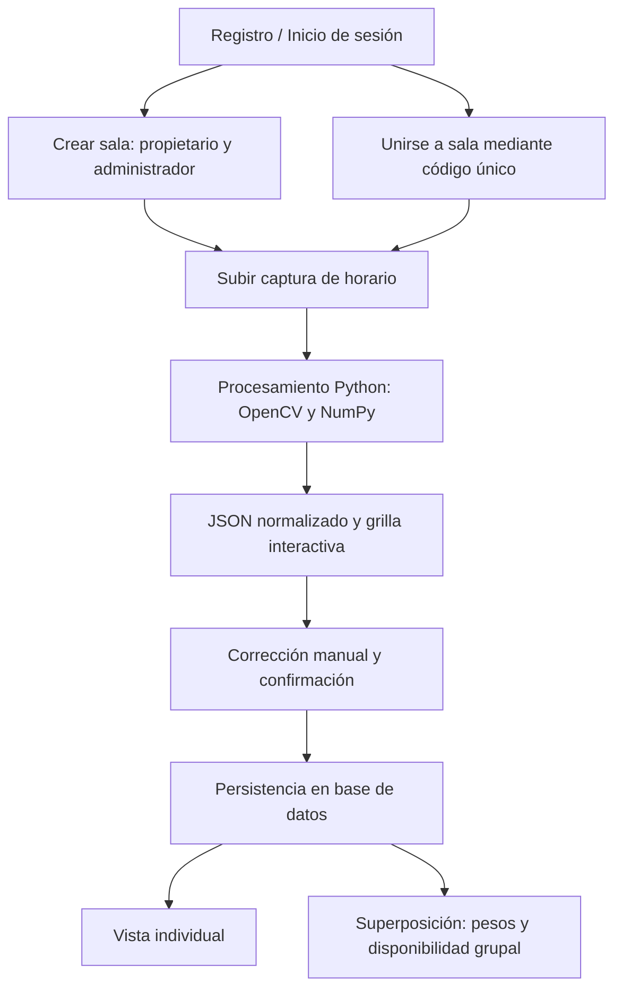
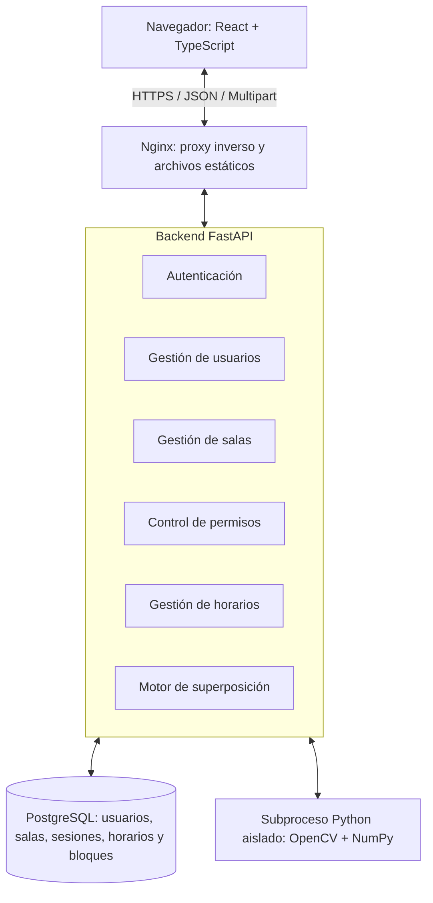
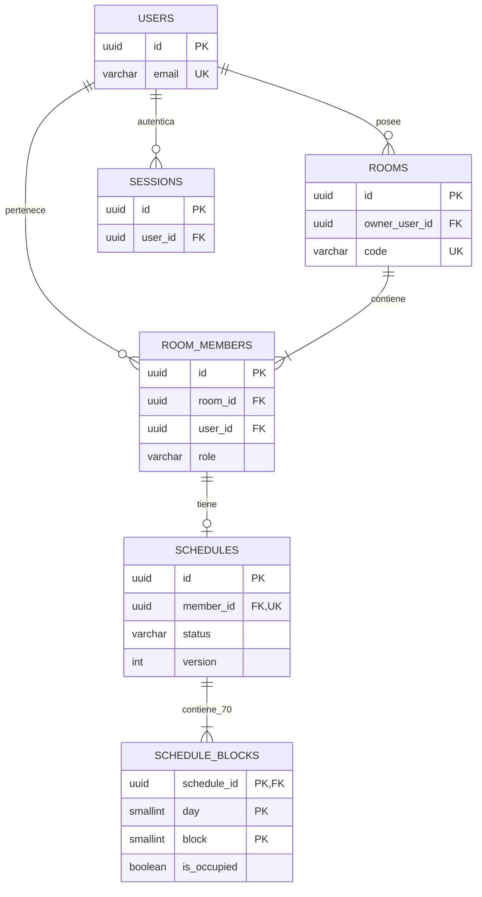
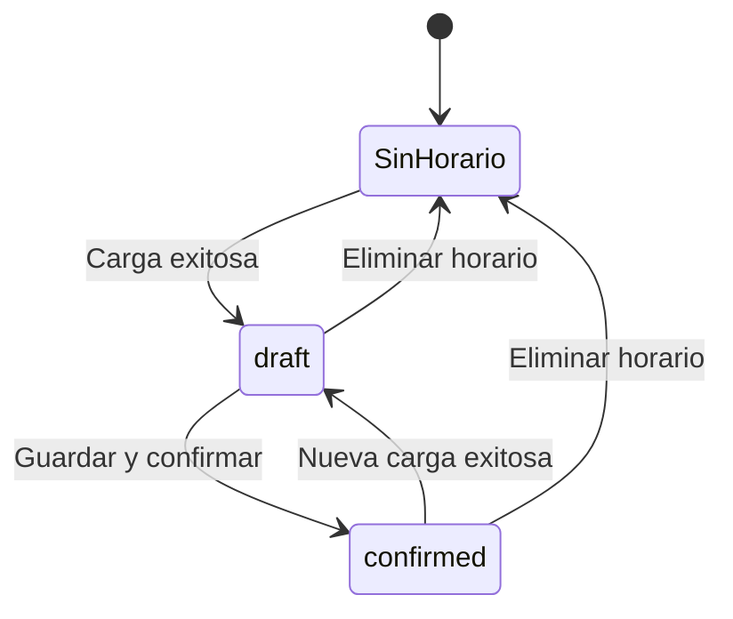
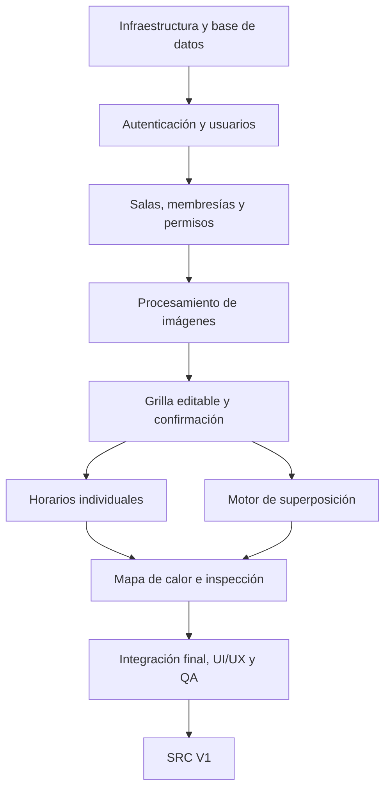

# SRC — Plan maestro de desarrollo de software

**Versión del producto:** MVP / V1  
**Nombre del software:** SRC  
**Tipo de sistema:** Aplicación web multiusuario para el análisis de disponibilidad horaria grupal.  
**Metodología recomendada:** Desarrollo incremental por fases, con criterios de aceptación y validación técnica antes de avanzar a la siguiente etapa.  
**Estado inicial:** Desarrollo de la plataforma desde cero, reutilizando el script existente de procesamiento de imágenes en Python.

> Nota de formato: las demostraciones interactivas, gráficos y listas de seguimiento del plan original se representan en este archivo mediante diagramas Mermaid, tablas, ejemplos y casillas Markdown. Son propuestas de diseño, no componentes ya implementados.

## Índice

- [0. Definición del producto y alcance del MVP](#0-definición-del-producto-y-alcance-del-mvp)
- [1. Arquitectura técnica y stack recomendado](#1-arquitectura-técnica-y-stack-recomendado)
- [2. Modelado de datos y esquema de base de datos](#2-modelado-de-datos-y-esquema-de-base-de-datos)
- [3. Especificación de endpoints y lógica de negocio](#3-especificación-de-endpoints-y-lógica-de-negocio)
- [4. Diseño de componentes frontend y flujos de interacción](#4-diseño-de-componentes-frontend-y-flujos-de-interacción)
- [5. Plan de desarrollo paso a paso](#5-plan-de-desarrollo-paso-a-paso)
- [6. Plan de pruebas y validación (QA)](#6-plan-de-pruebas-y-validación-qa)
- [7. Organización técnica del equipo](#7-organización-técnica-del-equipo)
- [8. Gestión de riesgos del proyecto](#8-gestión-de-riesgos-del-proyecto)
- [9. Priorización de funcionalidades y dependencias](#9-priorización-de-funcionalidades-y-dependencias)
- [10. Documentación y entrega final del MVP](#10-documentación-y-entrega-final-del-mvp)
- [11. Recursos técnicos oficiales](#11-recursos-técnicos-oficiales)
- [12. Conclusión y recomendación técnica final](#12-conclusión-y-recomendación-técnica-final)

---

# 0. Definición del producto y alcance del MVP

## 0.1. Objetivo general

Desarrollar una plataforma web que permita a múltiples usuarios compartir sus horarios académicos dentro de espacios de trabajo denominados **salas**, posibilitando que los administradores identifiquen visualmente los bloques horarios de mayor y menor disponibilidad mediante un sistema de superposición de horarios con pesos de ocupación.

SRC deberá transformar un proceso tradicionalmente manual —comparar los horarios de numerosas personas— en un proceso automatizado, visual, interactivo y centralizado.

## 0.2. Alcance funcional

| Funcionalidad | V1 |
|---|---|
| Registro e inicio de sesión | Incluido |
| Gestión del perfil | Incluido |
| Eliminación permanente de cuenta | Incluido |
| Creación de salas | Incluido |
| Ingreso a salas mediante código único | Incluido |
| Gestión de administradores locales | Incluido |
| Procesamiento de capturas mediante Python | Incluido |
| Edición manual de horarios | Incluido |
| Visualización individual de horarios | Incluido |
| Superposición de horarios | Incluido |
| Cálculo de pesos de ocupación | Incluido |
| Mapa de calor interactivo | Incluido |
| Inspección de disponibilidad por bloque | Incluido |
| Presentación de SRC y equipo desarrollador | Incluido |
| Guía de uso | Incluido |
| Agendamiento de reuniones | Excluido |
| Creación de eventos | Excluido |
| Sistema de invitaciones | Excluido |
| Gestión de ayudantías | Excluido |
| Programación de evaluaciones | Excluido |

**La responsabilidad funcional de SRC V1 termina en la visualización y el análisis de disponibilidad horaria.** Ninguna fase deberá implementar módulos de agendamiento, eventos o coordinación posterior.

## 0.3. Flujo general del sistema



## 0.4. Reglas de negocio fundamentales

| Código | Regla de negocio |
|---|---|
| RN-01 | Todos los usuarios tienen los mismos privilegios globales. |
| RN-02 | Los permisos administrativos existen exclusivamente dentro de cada sala. |
| RN-03 | Una sala tiene exactamente un propietario. |
| RN-04 | El propietario posee todos los permisos de un administrador. |
| RN-05 | Una sala puede tener múltiples administradores. |
| RN-06 | Un usuario puede pertenecer a múltiples salas. |
| RN-07 | Un usuario tiene como máximo un horario vigente por sala. |
| RN-08 | Cada horario contiene exactamente 70 celdas: 7 días y 10 bloques. |
| RN-09 | Cada celda de un horario confirmado representa un estado libre u ocupado. |
| RN-10 | Ningún administrador puede modificar el horario personal de otro miembro. |
| RN-11 | El peso de una celda corresponde al número exacto de miembros con ocupación confirmada en ese bloque. |
| RN-12 | Los cambios confirmados en un horario deben reflejarse en la siguiente consulta de superposición. |
| RN-13 | Los usuarios ajenos a una sala no pueden consultar sus horarios ni sus miembros. |
| RN-14 | La eliminación de una cuenta no puede dejar salas sin propietario ni registros huérfanos. |
| RN-15 | Un horario no cargado o pendiente de confirmar no equivale a un horario libre. |

### Consideración crítica: miembros sin horario cargado

Supongamos que una sala tiene 20 miembros, pero únicamente 15 han cargado y confirmado su horario. Si un bloque tiene peso 0, no es correcto afirmar que las 20 personas están disponibles.

| Categoría | Cantidad |
|---|---:|
| Disponibles (horario confirmado) | 15 |
| Ocupados (peso del bloque) | 0 |
| Sin información (horario pendiente) | 5 |

En este ejemplo, el peso es efectivamente 0, pero la disponibilidad total todavía no puede garantizarse.

Se propone incorporar un estado de borrador y confirmación del horario. Esto permitirá que los usuarios revisen los resultados del script antes de que sean considerados dentro del cálculo grupal.

Esta decisión, junto con las políticas de transferencia de propiedad que se detallan más adelante, constituye una propuesta técnica adicional para resolver situaciones no especificadas explícitamente en los requerimientos originales.

---

# 1. Arquitectura técnica y stack recomendado

## 1.1. Selección del stack tecnológico

Para SRC se recomienda una arquitectura de **monolito modular con frontend desacoplado y una API REST desarrollada en Python**.

La razón principal es que el procesamiento de imágenes, uno de los componentes centrales de SRC, ya está desarrollado en Python. Utilizar ese mismo lenguaje en el backend permitirá reducir la complejidad de integración.

| Capa | Tecnología recomendada | Justificación |
|---|---|---|
| Frontend | React + TypeScript | Componentes reutilizables e interfaces interactivas. |
| Empaquetador | Vite | Entorno de desarrollo ligero y rápido. |
| Navegación | React Router | Rutas públicas, protegidas y anidadas. |
| Estilos | Tailwind CSS | Consistencia visual y diseño adaptable. |
| Estado del servidor | TanStack Query | Consultas, invalidación de datos y sincronización con la API. |
| Backend | Python + FastAPI | Integración natural con el script existente y validación de datos. |
| Validación | Pydantic | Contratos y esquemas de entrada y salida. |
| Servidor ASGI | Uvicorn | Ejecución de FastAPI. |
| ORM | SQLAlchemy 2 | Persistencia y gestión de transacciones. |
| Migraciones | Alembic | Control de versiones de la base de datos. |
| Base de datos | PostgreSQL | Integridad referencial, restricciones y transacciones. |
| Procesamiento de imágenes | OpenCV + NumPy | Reutilización del activo técnico existente. |
| Seguridad | Argon2id + sesiones | Protección de contraseñas y autenticación revocable. |
| Infraestructura | Docker + Docker Compose | Entornos reproducibles para el equipo. |
| Proxy inverso | Nginx | Exposición del frontend y API mediante un mismo dominio. |
| Control de versiones | Git + GitHub | Desarrollo colaborativo. |
| CI/CD | GitHub Actions | Automatización de compilación y pruebas. |
| Testing backend | Pytest | Pruebas unitarias y de integración. |
| Testing frontend | Vitest + Testing Library | Pruebas de componentes y lógica. |
| Testing E2E | Playwright | Validación de flujos completos. |

FastAPI admite directamente la recepción de archivos mediante `UploadFile` y formularios `multipart/form-data`, lo que resulta especialmente conveniente para el módulo de carga de horarios. Véase [FastAPI: Request Files](https://fastapi.tiangolo.com/tutorial/request-files/).

### ¿Por qué FastAPI en lugar de Node.js?

Ambas tecnologías son viables. Sin embargo, FastAPI evita mantener dos entornos de ejecución diferentes en el backend y facilita la reutilización del código existente.

| Aspecto | FastAPI | Node.js + Express |
|---|---|---|
| Integración con OpenCV en Python | Directa | Requiere integración externa |
| Validación de datos | Pydantic | Biblioteca adicional |
| Documentación OpenAPI | Automática | Requiere configuración |
| Lenguajes en el backend | Python | JavaScript/TypeScript y Python |
| Complejidad inicial para SRC | Baja | Moderada |
| Adecuación al MVP | Muy alta | Alta |

**Recomendación:** React para la interfaz y FastAPI para toda la lógica de negocio, incluyendo la integración controlada del procesador de imágenes.

## 1.2. Arquitectura general del sistema



## 1.3. Decisión arquitectónica: monolito modular

No se recomienda construir una arquitectura completa de microservicios para esta primera versión. SRC no presenta inicialmente una complejidad que justifique mantener múltiples API, sistemas de mensajería, servicios de descubrimiento o infraestructura distribuida.

| Módulo | Responsabilidad |
|---|---|
| Auth | Registro, login, logout y sesiones. |
| Users | Perfil y eliminación de cuenta. |
| Rooms | Creación, consulta y eliminación de salas. |
| Members | Membresías y permisos locales. |
| Schedules | Persistencia y edición de horarios. |
| Image Processing | Integración con el script existente. |
| Overlap | Cálculo de pesos y disponibilidad. |
| Core | Configuración, seguridad y manejo de errores. |

Esta organización permitirá convertir el procesador de imágenes en un microservicio independiente en el futuro, si el volumen de procesamiento lo justifica, sin tener que rediseñar la lógica de negocio.

## 1.4. Estructura recomendada del repositorio

Se recomienda utilizar un único repositorio para todo el proyecto.

```text
SRC/
├── frontend/
│   ├── src/
│   │   ├── app/
│   │   │   ├── routes/
│   │   │   ├── providers/
│   │   │   └── App.tsx
│   │   ├── pages/
│   │   │   ├── home/
│   │   │   ├── login/
│   │   │   ├── register/
│   │   │   ├── rooms/
│   │   │   ├── room-detail/
│   │   │   ├── settings/
│   │   │   └── guide/
│   │   ├── features/
│   │   │   ├── auth/
│   │   │   ├── rooms/
│   │   │   ├── members/
│   │   │   ├── schedules/
│   │   │   ├── overlap/
│   │   │   └── account/
│   │   ├── entities/
│   │   │   ├── user/
│   │   │   ├── room/
│   │   │   └── schedule/
│   │   ├── widgets/
│   │   │   ├── sidebar/
│   │   │   ├── schedule-grid/
│   │   │   └── overlap-grid/
│   │   ├── shared/
│   │   │   ├── api/
│   │   │   ├── components/
│   │   │   ├── hooks/
│   │   │   ├── constants/
│   │   │   └── utils/
│   │   └── assets/
│   ├── tests/
│   ├── package.json
│   └── Dockerfile
├── backend/
│   ├── app/
│   │   ├── main.py
│   │   ├── core/
│   │   │   ├── config.py
│   │   │   ├── database.py
│   │   │   ├── security.py
│   │   │   └── exceptions.py
│   │   ├── auth/
│   │   ├── users/
│   │   ├── rooms/
│   │   ├── members/
│   │   ├── schedules/
│   │   ├── overlap/
│   │   └── image_processing/
│   │       ├── original_script.py
│   │       ├── adapter.py
│   │       ├── worker.py
│   │       ├── schemas.py
│   │       └── validators.py
│   ├── migrations/
│   ├── tests/
│   │   ├── unit/
│   │   ├── integration/
│   │   └── fixtures/
│   ├── requirements.txt
│   ├── alembic.ini
│   └── Dockerfile
├── e2e/
├── infrastructure/
│   └── nginx/
├── docs/
│   ├── architecture.md
│   ├── database.md
│   ├── api.md
│   ├── business-rules.md
│   └── development-plan.md
├── .github/
│   └── workflows/
├── docker-compose.yml
├── .env.example
├── .gitignore
└── README.md
```

Dentro de cada módulo del backend se utilizará una estructura semejante a la siguiente:

```text
rooms/
├── router.py
├── service.py
├── repository.py
├── models.py
├── schemas.py
└── dependencies.py
```

- `router.py`: recepción de solicitudes HTTP.
- `service.py`: aplicación de reglas de negocio.
- `repository.py`: consultas y operaciones de persistencia.
- `models.py`: entidades SQLAlchemy.
- `schemas.py`: validación de datos mediante Pydantic.
- `dependencies.py`: dependencias y validación de permisos.

No se deberán implementar reglas de negocio directamente dentro de los endpoints.

## 1.5. Infraestructura de despliegue

| Contenedor | Responsabilidad | Puerto interno |
|---|---|---:|
| frontend/proxy | Nginx y aplicación React compilada | 80 |
| backend | API FastAPI y procesador Python | 8000 |
| database | PostgreSQL | 5432 |

En producción, únicamente el proxy deberá estar expuesto públicamente mediante HTTPS. El backend y la base de datos permanecerán dentro de la red privada de Docker.

Variables de entorno iniciales propuestas:

```env
APP_ENV=development
APP_PORT=8000
DATABASE_URL=postgresql+psycopg://...
APP_ORIGIN=http://localhost:3000
SESSION_TTL_HOURS=24
SESSION_IDLE_MINUTES=60
MAX_UPLOAD_MB=5
MAX_IMAGE_PIXELS=12000000
IMAGE_PROCESSING_TIMEOUT_SECONDS=15
IMAGE_PROCESSING_CONCURRENCY=2
ROOM_CODE_LENGTH=12
MAX_ROOM_MEMBERS=100
```

Los límites de 5 MiB, 12 millones de píxeles, 15 segundos de procesamiento y 100 miembros son **valores iniciales propuestos**, no restricciones originales del producto. Deberán validarse mediante pruebas con el script real y ajustarse antes del despliegue.

---

# 2. Modelado de datos y esquema de base de datos

## 2.1. Entidades principales

SRC requiere cinco entidades centrales y una entidad adicional para gestionar las sesiones de autenticación.



## 2.2. Tabla `users`

| Campo | Tipo PostgreSQL | Restricción |
|---|---|---|
| id | UUID | PK |
| name | VARCHAR(100) | NOT NULL |
| email | VARCHAR(254) | UNIQUE, NOT NULL |
| password_hash | TEXT | NOT NULL |
| created_at | TIMESTAMPTZ | NOT NULL |
| updated_at | TIMESTAMPTZ | NOT NULL |

El correo se almacenará normalizado, sin espacios exteriores y en minúsculas. La unicidad debe estar garantizada por la base de datos. No se debe incorporar una columna `global_role`, puesto que todos los usuarios poseen los mismos privilegios globales. La contraseña jamás deberá almacenarse en texto plano.

## 2.3. Tabla `rooms`

| Campo | Tipo PostgreSQL | Restricción |
|---|---|---|
| id | UUID | PK |
| name | VARCHAR(100) | NOT NULL |
| description | VARCHAR(500) | NULL |
| code | VARCHAR(12) | UNIQUE, NOT NULL |
| owner_user_id | UUID | FK → users.id, NOT NULL |
| owner_role | TEXT | Valor fijo `admin`, NOT NULL |
| created_at | TIMESTAMPTZ | NOT NULL |
| updated_at | TIMESTAMPTZ | NOT NULL |

| Identificador | Ejemplo | Uso |
|---|---|---|
| ID interno | UUID | Consultas, relaciones y endpoints. |
| Código de sala | `K7M4X9P2QR6T` | Compartir una sala con otros usuarios. |

El código debe generarse mediante un generador criptográficamente seguro, utilizando un alfabeto de 32 caracteres que evite símbolos ambiguos.

```python
import secrets

ALPHABET = "ABCDEFGHJKLMNPQRSTUVWXYZ23456789"

def generate_room_code():
    return "".join(
        secrets.choice(ALPHABET)
        for _ in range(12)
    )
```

Se debe aplicar una restricción `UNIQUE` y reintentar la inserción si ocurre una colisión. Una consulta previa para comprobar que el código no existe no es suficiente por sí sola, debido a posibles solicitudes concurrentes.

## 2.4. Tabla `room_members`

| Campo | Tipo PostgreSQL | Restricción |
|---|---|---|
| id | UUID | PK |
| room_id | UUID | FK → rooms.id, NOT NULL |
| user_id | UUID | FK → users.id, NOT NULL |
| role | VARCHAR(10) | `admin` o `member`, NOT NULL |
| joined_at | TIMESTAMPTZ | NOT NULL |
| updated_at | TIMESTAMPTZ | NOT NULL |

Restricciones:

```sql
UNIQUE (room_id, user_id)
UNIQUE (room_id, user_id, role)
CHECK (role IN ('admin', 'member'))
```

### Representación del propietario

El propietario no necesita almacenarse como un rol adicional en esta tabla. Se considera propietario si `rooms.owner_user_id == usuario.id` y administrador si `room_members.role == "admin"`.

El propietario debe tener obligatoriamente una membresía con rol `admin`. Para garantizarlo también desde PostgreSQL, se propone una clave foránea compuesta diferible:

```sql
ALTER TABLE rooms
ADD CONSTRAINT fk_room_owner_membership
FOREIGN KEY (id, owner_user_id, owner_role)
REFERENCES room_members (room_id, user_id, role)
DEFERRABLE INITIALLY DEFERRED;
```

La columna `owner_role` debe estar restringida mediante `CHECK (owner_role = 'admin')` y ser `NOT NULL`. Esto permite crear la sala y la membresía del propietario en una misma transacción y verificar la consistencia al confirmarla. Véase [PostgreSQL: Constraints](https://www.postgresql.org/docs/current/ddl-constraints.html).

El frontend recibirá tres posibles roles efectivos:

- `owner`: propietario con permisos administrativos.
- `admin`: administrador local.
- `member`: miembro regular.

## 2.5. Tabla `schedules`

| Campo | Tipo PostgreSQL | Restricción |
|---|---|---|
| id | UUID | PK |
| member_id | UUID | FK → room_members.id, UNIQUE, NOT NULL |
| status | VARCHAR(15) | `draft` o `confirmed` |
| version | INTEGER | NOT NULL, mayor o igual a 1 |
| created_at | TIMESTAMPTZ | NOT NULL |
| updated_at | TIMESTAMPTZ | NOT NULL |
| confirmed_at | TIMESTAMPTZ | NULL |

La asociación mediante `member_id` garantiza que cada horario pertenezca simultáneamente a un usuario y a una sala válidos, sin duplicar innecesariamente información.

### Estados de un horario



- **Sin horario:** no existe registro en `schedules`.
- **Borrador (`draft`):** puede corregirse manualmente; no participa en la superposición.
- **Confirmado (`confirmed`):** participa en la superposición.

Si un miembro vuelve a cargar una captura, su horario se reemplazará por un nuevo borrador únicamente cuando el procesamiento sea exitoso. Deberá existir una advertencia previa, porque el horario dejará temporalmente de participar en el cálculo grupal hasta confirmarse nuevamente. Si la carga falla, el horario anterior permanece intacto.

La columna `version` permitirá detectar actualizaciones concurrentes y evitar que una pestaña antigua sobrescriba modificaciones más recientes.

## 2.6. Tabla `schedule_blocks`

| Campo | Tipo PostgreSQL | Restricción |
|---|---|---|
| schedule_id | UUID | FK → schedules.id |
| day | SMALLINT | Entre 1 y 7 |
| block | SMALLINT | Entre 1 y 10 |
| is_occupied | BOOLEAN | NOT NULL |

Clave primaria compuesta:

```sql
PRIMARY KEY (schedule_id, day, block)
```

Restricciones:

```sql
CHECK (day BETWEEN 1 AND 7)
CHECK (block BETWEEN 1 AND 10)
```

### Codificación de días y bloques

| ID | Día | ID de bloque | Bloque |
|---:|---|---:|---|
| 1 | Lunes | 1 | 1-2 |
| 2 | Martes | 2 | 3-4 |
| 3 | Miércoles | 3 | 5-6 |
| 4 | Jueves | 4 | 7-8 |
| 5 | Viernes | 5 | 9-10 |
| 6 | Sábado | 6 | 11-12 |
| 7 | Domingo | 7 | 13-14 |
| | | 8 | 15-16 |
| | | 9 | 17-18 |
| | | 10 | 19-20 |

Se recomienda almacenar las 70 celdas explícitamente, incluyendo las libres. Almacenar únicamente las ocupadas dificultaría distinguir errores de extracción, datos incompletos y bloques efectivamente libres.

Las restricciones de la tabla evitan duplicados y coordenadas inválidas. El servicio de horarios deberá validar adicionalmente que existan exactamente 70 celdas antes de confirmar una transacción. Si se desea reforzar esta garantía frente a modificaciones directas de la base de datos, puede incorporarse un trigger de restricción diferible.

## 2.7. Tabla `sessions`

| Campo | Tipo | Restricción |
|---|---|---|
| id | UUID | PK |
| user_id | UUID | FK → users.id, NOT NULL |
| token_hash | TEXT | UNIQUE, NOT NULL |
| csrf_token_hash | TEXT | NOT NULL |
| created_at | TIMESTAMPTZ | NOT NULL |
| expires_at | TIMESTAMPTZ | NOT NULL |
| last_activity_at | TIMESTAMPTZ | NOT NULL |

Se utilizarán identificadores de sesión opacos y aleatorios, transmitidos mediante cookies seguras. La base de datos almacenará el hash del identificador, no el token original. Esto permitirá invalidar inmediatamente todas las sesiones de un usuario al eliminar su cuenta.

## 2.8. Relaciones y reglas de eliminación

| Entidad referenciada | Entidad dependiente | Política |
|---|---|---|
| Users | Sessions | `ON DELETE CASCADE` |
| Users | RoomMembers | `ON DELETE CASCADE` |
| Users | Rooms como propietario | `ON DELETE RESTRICT` |
| Rooms | RoomMembers | `ON DELETE CASCADE` |
| RoomMembers | Schedules | `ON DELETE CASCADE` |
| Schedules | ScheduleBlocks | `ON DELETE CASCADE` |

**No se debe aplicar `ON DELETE CASCADE` directamente entre el propietario y sus salas**, ya que eliminar una cuenta podría destruir involuntariamente los horarios de todos los demás miembros.

## 2.9. Política de eliminación permanente de cuenta

| Situación del usuario | Resultado |
|---|---|
| No pertenece a ninguna sala | Se elimina su cuenta y sus sesiones. |
| Es miembro regular | Se elimina su membresía y su horario. |
| Es administrador | Se elimina su membresía, su horario y sus permisos. |
| Es propietario y único miembro | Se elimina la sala completa. |
| Es propietario y existen otros miembros | Debe transferir la propiedad o confirmar explícitamente el cierre de la sala. |

Cuando existan otros miembros, SRC deberá recomendar como nuevo propietario al administrador con mayor antigüedad. Si no existe otro administrador, recomendará al miembro más antiguo, al cual se promoverá automáticamente al realizar la transferencia.

La transferencia deberá ser confirmada por el usuario antes de eliminar la cuenta.

### Procedimiento transaccional

```text
BEGIN TRANSACTION
1. Verificar nuevamente la identidad del usuario.
2. Bloquear los registros relevantes.
3. Consultar las salas de las que es propietario.
4. Validar las decisiones de transferencia o cierre.
5. Promover a los nuevos propietarios cuando corresponda.
6. Actualizar la propiedad de las salas conservadas.
7. Eliminar las salas cuyo cierre fue confirmado.
8. Eliminar el usuario.
9. Ejecutar las eliminaciones en cascada.
10. Confirmar la transacción.
COMMIT
```

Si cualquier operación falla, se ejecutará `ROLLBACK`.

La eliminación deberá comprender también las sesiones, datos temporales y cachés relacionados. Si existen copias de seguridad, deberán quedar sujetas a una política documentada de expiración y restauración; no se debe prometer que una eliminación de la base activa borra instantáneamente todas las copias de respaldo.

---

# 3. Especificación de endpoints y lógica de negocio

## 3.1. Convenciones generales de la API

Todas las rutas deberán utilizar el prefijo `/api/v1`. Se utilizará JSON para las operaciones convencionales y `multipart/form-data` para subir imágenes.

Formato estándar de error:

```json
{
  "error": {
    "code": "ROOM_ACCESS_DENIED",
    "message": "No tienes permisos para acceder a esta sala.",
    "details": null
  }
}
```

| Código HTTP | Significado |
|---:|---|
| 200 | Operación exitosa. |
| 201 | Recurso creado. |
| 204 | Operación exitosa sin contenido. |
| 400 | Solicitud incorrecta. |
| 401 | Autenticación requerida o inválida. |
| 403 | Usuario autenticado sin permisos suficientes. |
| 404 | Recurso inexistente o inaccesible por aislamiento. |
| 409 | Conflicto de estado o versión. |
| 413 | Archivo demasiado grande. |
| 415 | Formato de archivo no admitido. |
| 422 | Datos inválidos o imagen no procesable. |
| 429 | Límite de solicitudes excedido. |
| 500 | Error interno inesperado. |
| 503 | Procesador temporalmente ocupado o no disponible. |

Los errores de validación nativos de FastAPI deberán adaptarse al formato estándar de la aplicación.

## 3.2. Endpoints de autenticación

| Método | Endpoint | Acceso | Éxito |
|---|---|---|---:|
| POST | `/auth/register` | Público | 201 |
| POST | `/auth/login` | Público | 200 |
| POST | `/auth/logout` | Autenticado | 204 |
| GET | `/auth/me` | Autenticado | 200 |

### `POST /auth/register`

Entrada:

```json
{
  "name": "Usuario de ejemplo",
  "email": "usuario@example.com",
  "password": "una-contrasena-segura"
}
```

Validaciones: nombre entre 2 y 100 caracteres, correo válido y único, contraseña de longitud inicial recomendada entre 15 y 128 caracteres y hash mediante Argon2id.

Respuesta `201`:

```json
{
  "id": "uuid-user",
  "name": "Usuario de ejemplo",
  "email": "usuario@example.com"
}
```

Se propone que el registro exitoso también cree la sesión del usuario.

### `POST /auth/login`

Entrada:

```json
{
  "email": "usuario@example.com",
  "password": "una-contrasena-segura"
}
```

Respuesta `200`:

```json
{
  "user": {
    "id": "uuid-user",
    "name": "Usuario de ejemplo",
    "email": "usuario@example.com"
  },
  "csrf_token": "token-de-proteccion-csrf"
}
```

La sesión se transmitirá mediante una cookie, no mediante un token almacenado en `localStorage`.

Configuración de seguridad en producción:

```text
HttpOnly
Secure
SameSite=Lax
Path=/
```

Las operaciones que modifican datos deberán incluir protección CSRF y validación de origen. El login y registro también deben validar el origen y el tipo de contenido. Se deberán aplicar límites de intentos por cuenta y dirección IP. Véanse las guías de OWASP sobre [autenticación](https://cheatsheetseries.owasp.org/cheatsheets/Authentication_Cheat_Sheet.html), [sesiones](https://cheatsheetseries.owasp.org/cheatsheets/Session_Management_Cheat_Sheet.html) y [CSRF](https://cheatsheetseries.owasp.org/cheatsheets/Cross-Site_Request_Forgery_Prevention_Cheat_Sheet.html).

### `GET /auth/me`

Devuelve el usuario autenticado y el token CSRF necesario para operar desde la aplicación. Permite restaurar el estado de autenticación al recargar la página.

### `POST /auth/logout`

Invalida la sesión actual en PostgreSQL y elimina la cookie correspondiente.

## 3.3. Endpoints de perfil y eliminación de cuenta

| Método | Endpoint | Éxito |
|---|---|---:|
| GET | `/users/me` | 200 |
| PATCH | `/users/me` | 200 |
| PUT | `/users/me/password` | 204 |
| GET | `/users/me/deletion-preview` | 200 |
| POST | `/users/me/deletion` | 204 |

### Actualización de perfil

```json
{
  "name": "Nuevo nombre"
}
```

Para modificar el correo deberá solicitarse adicionalmente la contraseña actual. Un cambio de contraseña también deberá exigir la contraseña anterior e invalidar las demás sesiones.

### Consulta previa a la eliminación

`GET /users/me/deletion-preview`

```json
{
  "memberships_count": 4,
  "schedules_count": 3,
  "owned_rooms": [
    {
      "room_id": "uuid-room",
      "name": "Grupo de estudio",
      "members_count": 8,
      "suggested_new_owner_id": "uuid-admin",
      "requires_decision": true
    }
  ]
}
```

### Confirmación de eliminación

`POST /users/me/deletion`

```json
{
  "current_password": "contrasena-actual",
  "confirmation": "ELIMINAR",
  "room_actions": [
    {
      "room_id": "uuid-room",
      "action": "transfer",
      "new_owner_id": "uuid-admin"
    }
  ]
}
```

La otra acción admitida será `close`. El backend deberá volver a consultar y validar las salas dentro de la transacción. Si la información cambió desde la consulta previa, retornará `409` y solicitará una nueva confirmación.

## 3.4. Endpoints de salas

| Método | Endpoint | Permiso | Éxito |
|---|---|---|---:|
| POST | `/rooms` | Autenticado | 201 |
| GET | `/rooms` | Autenticado | 200 |
| POST | `/rooms/join` | Autenticado | 201/200 |
| GET | `/rooms/{room_id}` | Miembro | 200 |
| PATCH | `/rooms/{room_id}` | Owner/Admin | 200 |
| DELETE | `/rooms/{room_id}` | Owner | 204 |
| DELETE | `/rooms/{room_id}/membership/me` | Miembro no propietario | 204 |
| POST | `/rooms/{room_id}/transfer-ownership` | Owner | 200 |

### Creación de sala

`POST /rooms`

```json
{
  "name": "Grupo de informática",
  "description": "Disponibilidad semanal del grupo"
}
```

Respuesta:

```json
{
  "id": "uuid-room",
  "name": "Grupo de informática",
  "code": "K7M4X9P2QR6T",
  "current_user_role": "owner",
  "members_count": 1
}
```

La creación de la sala y la incorporación del propietario como administrador deberán ocurrir dentro de una única transacción.

### Ingreso mediante código

`POST /rooms/join`

```json
{
  "code": "K7M4X9P2QR6T"
}
```

Procedimiento:

1. Verificar autenticación.
2. Normalizar el código.
3. Buscar la sala correspondiente.
4. Bloquear el registro de sala durante la incorporación.
5. Comprobar si el usuario ya es miembro.
6. Verificar el límite de miembros configurado.
7. Crear una membresía con rol `member`.
8. Retornar la información de la sala.

Un usuario que ya pertenece a la sala recibirá `200` y su membresía existente, sin generar duplicados.

Se recomienda que únicamente los propietarios y administradores puedan consultar el código desde la interfaz de la sala. La incorporación mediante un código válido seguirá estando abierta a cualquier usuario autenticado.

## 3.5. Endpoints de miembros y administradores

| Método | Endpoint | Permiso |
|---|---|---|
| GET | `/rooms/{room_id}/members` | Owner/Admin |
| PATCH | `/rooms/{room_id}/members/{member_id}/role` | Owner/Admin, sujeto a reglas |
| DELETE | `/rooms/{room_id}/members/{member_id}` | Owner |

### Consulta de miembros

```json
{
  "members": [
    {
      "id": "uuid-member-1",
      "user_id": "uuid-user-1",
      "name": "Integrante A",
      "role": "owner",
      "schedule_status": "confirmed"
    },
    {
      "id": "uuid-member-2",
      "user_id": "uuid-user-2",
      "name": "Integrante B",
      "role": "member",
      "schedule_status": "missing"
    }
  ]
}
```

No se deben retornar contraseñas, sesiones ni correos electrónicos de otros miembros.

### Promoción de administrador

`PATCH /rooms/{room_id}/members/{member_id}/role`

```json
{
  "role": "admin"
}
```

Los propietarios y administradores podrán promover miembros regulares. La revocación de permisos administrativos se reservará exclusivamente al propietario para evitar conflictos entre administradores.

## 3.6. Matriz de permisos

| Operación | Miembro | Admin | Owner |
|---|:---:|:---:|:---:|
| Acceder a su sala | Sí | Sí | Sí |
| Subir su horario | Sí | Sí | Sí |
| Editar su horario | Sí | Sí | Sí |
| Consultar su horario | Sí | Sí | Sí |
| Consultar otros horarios confirmados | No | Sí | Sí |
| Visualizar superposición | No | Sí | Sí |
| Inspeccionar miembros por bloque | No | Sí | Sí |
| Consultar listado de miembros | No | Sí | Sí |
| Promover administradores | No | Sí | Sí |
| Revocar permisos administrativos | No | No | Sí |
| Modificar información de la sala | No | Sí | Sí |
| Expulsar miembros | No | No | Sí |
| Transferir propiedad | No | No | Sí |
| Eliminar sala | No | No | Sí |
| Editar horarios ajenos | No | No | No |
| Abandonar la sala directamente | Sí | Sí | No |

La expulsión de miembros, revocación de administradores y transferencia directa de propiedad son operaciones complementarias propuestas para completar el ciclo de gestión de salas.

### Middleware y dependencias de autorización

En FastAPI se recomienda implementar dependencias reutilizables:

```python
get_current_user()
require_room_member()
require_room_admin()
require_room_owner()
```

Orden de validación:

```text
¿Existe una sesión válida?
        ↓
¿El usuario pertenece a la sala?
        ↓
¿Posee el permiso requerido?
        ↓
¿El recurso solicitado pertenece a esa sala?
        ↓
Ejecutar la operación
```

Nunca debe confiarse en un rol enviado por el frontend. El rol local deberá consultarse en la base de datos. Las operaciones de escritura deberán verificar nuevamente el permiso cuando se ejecute la transacción correspondiente.

## 3.7. Endpoints de horarios

| Método | Endpoint | Permiso | Éxito |
|---|---|---|---:|
| GET | `/rooms/{room_id}/schedules/me` | Miembro | 200 |
| POST | `/rooms/{room_id}/schedules/me/upload` | Miembro | 200/201 |
| PUT | `/rooms/{room_id}/schedules/me` | Miembro | 200 |
| DELETE | `/rooms/{room_id}/schedules/me` | Miembro | 204 |
| GET | `/rooms/{room_id}/members/{member_id}/schedule` | Owner/Admin | 200 |

### Consulta de horario propio

Ejemplo abreviado:

```json
{
  "schedule_id": "uuid-schedule",
  "status": "draft",
  "version": 1,
  "blocks": [
    {"day": 1, "block": 1, "is_occupied": true},
    {"day": 1, "block": 2, "is_occupied": false}
  ]
}
```

El arreglo completo deberá contener las 70 celdas. Si todavía no existe un horario, se responderá con `status: "missing"`, `schedule_id: null`, `version: 0` y un arreglo vacío.

### Guardado y confirmación del horario

`PUT /rooms/{room_id}/schedules/me`

```json
{
  "expected_version": 1,
  "blocks": [
    {"day": 1, "block": 1, "is_occupied": true},
    {"day": 1, "block": 2, "is_occupied": false}
  ]
}
```

El ejemplo está abreviado; una solicitud real deberá contener las 70 celdas.

El servidor deberá validar:

- Existencia del horario y pertenencia al usuario autenticado.
- Exactamente 70 coordenadas distintas.
- Días y bloques dentro de los rangos establecidos.
- Valores booleanos estrictos.
- Coincidencia de la versión enviada con la almacenada.

Si todo es correcto, se guardarán los bloques en una sola transacción, el estado pasará a `confirmed` y se incrementará la versión. Una actualización con versión obsoleta devolverá `409 SCHEDULE_VERSION_CONFLICT`.

### Consulta de horarios ajenos

Los administradores únicamente podrán visualizar horarios confirmados. Si un miembro aún está revisando su horario, se mostrará su estado pendiente, pero no se expondrá el contenido del borrador.

## 3.8. Integración del script Python existente

Esta integración debe realizarse sin mezclar las responsabilidades del procesamiento de imágenes con la lógica de FastAPI o PostgreSQL.

| Archivo | Responsabilidad |
|---|---|
| `original_script.py` | Algoritmo existente de OpenCV y NumPy. |
| `adapter.py` | Transformar la salida del script al contrato de SRC. |
| `worker.py` | Ejecutar el procesamiento en un proceso separado. |
| `validators.py` | Validar archivos, estructura y coordenadas. |
| `schemas.py` | Definir los contratos Pydantic. |

### Flujo técnico completo

1. **Recepción de captura:** multipart con archivo y versión esperada.
2. **Validación:** permisos, tamaño, formato y límites de procesamiento.
3. **Archivo temporal:** nombre aleatorio y directorio privado.
4. **Ejecución del script:** subproceso Python con tiempo máximo y concurrencia limitada.
5. **Validación del JSON:** normalización de días, bloques y estados.
6. **Persistencia:** transacción que almacena el horario borrador y sus 70 celdas.
7. **Respuesta y limpieza:** retornar horario y eliminar archivo temporal.

### Contrato de salida del script

Suponiendo una salida similar a:

```json
[
  {"dia": "Lunes", "bloque": "3-4", "estado": "ocupado"},
  {"dia": "Viernes", "bloque": "11-12", "estado": "ocupado"}
]
```

El adaptador deberá convertirla a:

```json
[
  {"day": 1, "block": 2, "is_occupied": true},
  {"day": 5, "block": 6, "is_occupied": true}
]
```

Finalmente construirá la matriz de 70 celdas.

### Algoritmo de normalización propuesto

```python
DAYS = {
    "lunes": 1,
    "martes": 2,
    "miércoles": 3,
    "jueves": 4,
    "viernes": 5,
    "sábado": 6,
    "domingo": 7
}

BLOCKS = {
    "1-2": 1,
    "3-4": 2,
    "5-6": 3,
    "7-8": 4,
    "9-10": 5,
    "11-12": 6,
    "13-14": 7,
    "15-16": 8,
    "17-18": 9,
    "19-20": 10
}
```

El adaptador deberá crear una grilla inicial, recorrer el JSON del script, traducir cada coordenada y asignar el estado correspondiente.

**Advertencia:** si el script retorna exclusivamente los bloques ocupados, será válido interpretar las coordenadas ausentes como libres solamente cuando se haya verificado que el procesamiento cubrió correctamente toda la grilla. Una salida vacía por error no puede convertirse silenciosamente en un horario completamente disponible.

No se ha inspeccionado el código fuente del script existente, por lo que su formato exacto, sus excepciones y su capacidad para detectar capturas incompletas deberán verificarse en la Fase 3 antes de cerrar el contrato del adaptador.

### Ejecución del subproceso

Ejemplo conceptual del mecanismo de integración:

```python
import subprocess
import sys

def process_image(image_path):
    result = subprocess.run(
        [
            sys.executable,
            "-m",
            "app.image_processing.worker",
            image_path
        ],
        capture_output=True,
        text=True,
        timeout=15,
        check=True,
        shell=False
    )

    return result.stdout
```

El worker deberá emitir exclusivamente JSON válido por `stdout` y enviar sus diagnósticos a `stderr`. El ejemplo es una base de implementación, no una integración probada con el script real.

### Medidas obligatorias de seguridad

| Riesgo | Medida |
|---|---|
| Archivos maliciosos | Admitir únicamente PNG y JPEG válidos, verificando contenido real. |
| Archivos demasiado grandes | Limitar tamaño en proxy y backend. |
| Imágenes de dimensiones excesivas | Validar cantidad de píxeles antes del procesamiento completo. |
| Saturación del servidor | Limitar cargas por usuario y procesos concurrentes. |
| Ejecución indefinida | Aplicar timeout y finalizar el proceso. |
| Inyección de comandos | Utilizar argumentos separados y `shell=False`. |
| Exposición de capturas | Almacenar temporalmente fuera del directorio público. |
| Archivos abandonados | Utilizar limpieza garantizada mediante `finally`. |
| Agotamiento de memoria | Limitar memoria y CPU del entorno de procesamiento. |
| Salida JSON inesperada | Validar mediante Pydantic antes de guardar. |

El subproceso debe ejecutarse fuera del event loop de FastAPI, con concurrencia controlada, sin privilegios de root y sin mantener una transacción abierta mientras analiza la captura. Véase [OWASP: File Upload Cheat Sheet](https://cheatsheetseries.owasp.org/cheatsheets/File_Upload_Cheat_Sheet.html).

### Persistencia de las imágenes

No se recomienda conservar las capturas originales en V1. Se almacenará exclusivamente la representación estructurada del horario. Esto reduce consumo de almacenamiento y exposición de posibles datos personales contenidos en las imágenes.

## 3.9. Motor de superposición con pesos

Este módulo constituye la funcionalidad central de SRC. El cálculo deberá realizarse en el backend. El frontend será responsable únicamente de representar gráficamente los resultados y permitir su inspección.

### Definición matemática

Sea:

- $M$: conjunto de todos los miembros de la sala.
- $C$: subconjunto de miembros con horario confirmado.
- $D=\{1,\ldots,7\}$: conjunto de días.
- $B=\{1,\ldots,10\}$: conjunto de bloques.

Se define el parámetro binario para cada miembro con horario confirmado:

$$
x_{m,d,b}=\begin{cases}
1 & \text{si el miembro está ocupado}\\
0 & \text{si el miembro está disponible}
\end{cases}
$$

El peso de ocupación de una celda estará dado por:

$$
W_{d,b}=\sum_{m\in C}x_{m,d,b}
$$

La cantidad de miembros disponibles será:

$$
A_{d,b}=|C|-W_{d,b}
$$

La cantidad de miembros sin información confirmada será:

$$
P=|M|-|C|
$$

Por lo tanto, siempre deberá cumplirse:

$$
W_{d,b}+A_{d,b}+P=|M|
$$

La intensidad relativa del mapa de calor se calculará como:

$$
I_{d,b}=\frac{W_{d,b}}{|M|}
$$

Cuando no existan miembros pendientes, un bloque de peso cero representará disponibilidad total.

### Ejemplo de cálculo

| Miembro | Estado en Lunes 3-4 | Aporte al peso |
|---|---|---:|
| Integrante A | Ocupado | 1 |
| Integrante B | Libre | 0 |
| Integrante C | Ocupado | 1 |
| Integrante D | Ocupado | 1 |
| Integrante E | Libre | 0 |
| **Total** | | **3** |

$$
W_{\text{Lunes},3-4}=1+0+1+1+0=3
$$

El peso es 3, existen 2 personas disponibles y la intensidad de ocupación relativa corresponde al 60%.

## 3.10. Algoritmo exacto de superposición

1. Verificar que el solicitante sea administrador o propietario.
2. Recuperar todos los miembros de la sala.
3. Recuperar sus horarios confirmados y respectivos bloques.
4. Construir una matriz inicial de 7 × 10 celdas con peso cero.
5. Clasificar a los miembros sin horario confirmado.
6. Recorrer los bloques de cada horario confirmado.
7. Incrementar el peso cuando el estado sea ocupado.
8. Calcular las cantidades disponibles y pendientes.
9. Obtener los pesos mínimo y máximo.
10. Retornar las 70 celdas y las métricas generales.

Implementación base en Python:

```python
def calculate_overlap(members, confirmed_schedules):
    total = len(members)
    confirmed = len(confirmed_schedules)
    pending = total - confirmed

    weights = [
        [0 for _ in range(10)]
        for _ in range(7)
    ]

    for schedule in confirmed_schedules:
        for cell in schedule["blocks"]:
            if cell["is_occupied"]:
                day = cell["day"] - 1
                block = cell["block"] - 1
                weights[day][block] += 1

    cells = []

    for day in range(7):
        for block in range(10):
            weight = weights[day][block]

            cells.append({
                "day": day + 1,
                "block": block + 1,
                "weight": weight,
                "available_count": confirmed - weight,
                "pending_count": pending,
                "intensity": weight / total if total else 0,
                "everyone_available": (
                    total > 0
                    and pending == 0
                    and weight == 0
                )
            })

    return {
        "total_members": total,
        "confirmed_members": confirmed,
        "pending_members": pending,
        "min_weight": min(c["weight"] for c in cells),
        "max_weight": max(c["weight"] for c in cells),
        "cells": cells
    }
```

El servicio deberá recibir exclusivamente horarios ya validados, sin registros duplicados y correspondientes a miembros vigentes de la sala.

### Complejidad computacional

Para $n$ miembros con horario confirmado, cada uno con 70 celdas:

$$
T(n)=O(70n)=O(n)
$$

| Miembros confirmados | Celdas procesadas |
|---:|---:|
| 10 | 700 |
| 50 | 3.500 |
| 100 | 7.000 |
| 250 | 17.500 |
| 500 | 35.000 |
| 750 | 52.500 |
| 1.000 | 70.000 |

El crecimiento es lineal, por lo que no es necesario incorporar algoritmos complejos de optimización, procesamiento paralelo ni una base de datos especializada para esta funcionalidad en el MVP.

La matriz de superposición tampoco deberá almacenarse como una tabla adicional. Se calculará dinámicamente a partir de los horarios vigentes, evitando inconsistencias cuando se eliminen usuarios, se abandonen salas o se modifiquen bloques.

## 3.11. Endpoints de superposición

| Método | Endpoint | Permiso |
|---|---|---|
| GET | `/rooms/{room_id}/overlap` | Owner/Admin |
| GET | `/rooms/{room_id}/overlap/cells/{day}/{block}` | Owner/Admin |

### Consulta consolidada

`GET /rooms/{room_id}/overlap`

Respuesta abreviada:

```json
{
  "room_id": "uuid-room",
  "total_members": 20,
  "confirmed_members": 18,
  "pending_members": 2,
  "min_weight": 0,
  "max_weight": 14,
  "coverage": 0.9,
  "cells": [
    {
      "day": 1,
      "block": 2,
      "weight": 14,
      "available_count": 4,
      "pending_count": 2,
      "intensity": 0.7,
      "everyone_available": false
    },
    {
      "day": 3,
      "block": 8,
      "weight": 0,
      "available_count": 18,
      "pending_count": 2,
      "intensity": 0,
      "everyone_available": false
    }
  ]
}
```

La respuesta real siempre incluirá las 70 celdas. La cobertura corresponde a la cantidad de miembros confirmados dividida por el total de miembros.

### Inspección individual de una celda

`GET /rooms/{room_id}/overlap/cells/1/2`

```json
{
  "day": 1,
  "block": 2,
  "weight": 2,
  "total_members": 5,
  "available_count": 2,
  "pending_count": 1,
  "occupied_members": [
    {"id": "uuid-member-1", "name": "Integrante A"},
    {"id": "uuid-member-2", "name": "Integrante B"}
  ],
  "available_members": [
    {"id": "uuid-member-3", "name": "Integrante C"},
    {"id": "uuid-member-4", "name": "Integrante D"}
  ],
  "pending_members": [
    {"id": "uuid-member-5", "name": "Integrante E"}
  ]
}
```

Separar la matriz de la consulta detallada evita enviar las listas completas de integrantes para las 70 celdas en cada solicitud.

### Consistencia de las consultas

El backend deberá recuperar miembros, horarios y bloques mediante una consulta consistente o una transacción de lectura con snapshot. Esto evita que una modificación concurrente produzca resultados incompatibles, por ejemplo, un peso superior al número de horarios confirmados.

La consulta de una celda puede representar un instante posterior al de la matriz principal. Si los valores difieren, el frontend deberá refrescar la matriz y actualizar el panel de detalle.

Para el MVP no es necesario utilizar WebSockets. Se recomienda actualizar los datos al ingresar en la vista, recuperar el foco de la ventana, pulsar el botón de actualización y mediante polling moderado mientras la vista administrativa esté activa.

---

# 4. Diseño de componentes frontend y flujos de interacción

## 4.1. Árbol de rutas

```text
/
├── /login
├── /register
│
├── /app
│   ├── /inicio
│   ├── /salas
│   │   └── /:roomId
│   │       ├── /mi-horario
│   │       ├── /miembros
│   │       ├── /horarios
│   │       ├── /superposicion
│   │       └── /configuracion
│   ├── /ajustes
│   └── /guia
│
├── /403
└── /404
```

La ruta `/` será la presentación pública de SRC, mientras que `/app/inicio` será el inicio del usuario autenticado. Ambas podrán reutilizar el mismo componente de presentación del software y del equipo desarrollador.

Las rutas administrativas deberán estar protegidas mediante:

```text
ProtectedRoute
    └── RoomMemberRoute
            └── RoomAdminRoute
```

Estas protecciones mejoran la navegación, pero no reemplazan la autorización implementada en el backend.

## 4.2. Layout general

La interfaz deberá mantener una barra lateral izquierda fija, utilizando el espacio restante para el contenido de la pantalla activa.

### Propuesta conceptual de la pantalla Inicio

```text
┌─────────────────────┬──────────────────────────────────────────────┐
│ SRC                 │ Inicio                                       │
│ ESPACIO DE TRABAJO  │                                              │
│                     │ Bienvenido a SRC                             │
│ > Inicio            │ Encuentra disponibilidad común y comparte    │
│   Salas             │ horarios con tu grupo.                       │
│   Ajustes           │                                              │
│                     │ [ Crear sala ]     [ Unirse a sala ]          │
│                     │                                              │
│                     │ Equipo desarrollador                         │
│                     │ [ Integrante 1 ]   [ Integrante 2 ]           │
│                     │                                              │
│ Guía / Cómo usar    │                                              │
└─────────────────────┴──────────────────────────────────────────────┘
```

La propuesta visual original contempla una barra lateral azul oscuro (`#172333`), un fondo de contenido claro (`#f5f7fa`), tarjetas blancas y acciones primarias azules (`#2563eb`). La identidad visual y los integrantes son referenciales.

La opción `Guía / Cómo usar` deberá permanecer en la parte inferior de la barra lateral mediante un layout Flexbox que distribuya el espacio disponible. En dispositivos móviles, la navegación podrá convertirse en una barra lateral desplegable.

## 4.3. Pantalla Salas

| Sección | Contenido |
|---|---|
| Salas creadas | Salas donde el usuario es propietario. |
| Salas unidas | Salas donde participa como administrador o miembro. |
| Crear sala | Formulario con nombre y descripción opcional. |
| Unirse a sala | Formulario para ingresar el código único. |
| Información de cada sala | Nombre, rol local, cantidad de miembros y estado del horario propio. |

Ejemplo de diseño referencial:

```text
Mis salas                         [+ Crear sala] [Unirse]

Salas creadas
┌────────────────────────────────────────────────────────┐
│ Grupo de informática                         >         │
│ 20 miembros · Propietario                              │
│ Código de sala: K7M4X9P2QR6T       [Copiar]             │
└────────────────────────────────────────────────────────┘

Salas unidas
┌────────────────────────────────────────────────────────┐
│ Grupo de estudio                             >         │
│ 8 miembros · Miembro                                   │
│ Horario confirmado                                     │
└────────────────────────────────────────────────────────┘
```

## 4.4. Espacio de trabajo dentro de una sala

La navegación interna dependerá del rol del usuario.

| Miembro regular | Administrador |
|---|---|
| Mi horario | Mi horario |
| Subir captura | Miembros |
| Información de sala | Horarios individuales |
| Abandonar sala | Superposición |
| | Configuración |

El propietario contará, adicionalmente, con las opciones de transferir propiedad, expulsar miembros y eliminar la sala.

## 4.5. Componente de grilla interactiva

Se recomienda implementar una grilla reutilizable con tres modos:

| Modo | Comportamiento |
|---|---|
| `editable` | Permite cambiar libre/ocupado. |
| `readonly` | Visualización de un horario individual. |
| `overlap` | Visualización de pesos de ocupación. |

Interfaz de datos:

```typescript
type Day = 1 | 2 | 3 | 4 | 5 | 6 | 7;

type Block =
  | 1 | 2 | 3 | 4 | 5
  | 6 | 7 | 8 | 9 | 10;

interface ScheduleCell {
  day: Day;
  block: Block;
  is_occupied: boolean;
}
```

### Prototipo de la edición manual

La siguiente tabla es una representación estática de la demostración interactiva del plan original. Cada celda se implementará como un control pulsable. `O` significa ocupado y `L` significa libre.

| Bloque | Lun | Mar | Mié | Jue | Vie | Sáb | Dom |
|---|:---:|:---:|:---:|:---:|:---:|:---:|:---:|
| 1-2 | O | O | L | O | L | L | L |
| 3-4 | O | L | O | O | L | L | L |
| 5-6 | O | L | O | O | L | L | L |
| 7-8 | O | L | L | O | L | L | L |
| 9-10 | O | L | O | O | L | L | L |
| 11-12 | L | O | L | L | L | L | L |
| 13-14 | O | L | O | O | L | L | L |
| 15-16 | L | O | L | O | L | L | L |
| 17-18 | L | L | O | L | L | L | L |
| 19-20 | L | L | L | L | L | L | L |

- **Ocupado:** fondo azul (`#4479b5`), icono o texto que indique ocupación.
- **Libre:** fondo verde claro (`#dceadf`).
- **Sin guardar:** indicador cuando la copia local difiere de la versión base.
- **Descartar:** recuperar la versión base.
- **Guardar horario:** confirmar los cambios.
- **Guardado:** mostrar confirmación solamente tras respuesta exitosa de la API.

### Lógica de implementación

El horario original retornado por el backend deberá conservarse como estado base. Las modificaciones se realizarán inicialmente sobre una copia local.

```typescript
function toggleCell(day: number, block: number) {
  setCells(previous =>
    previous.map(cell =>
      cell.day === day && cell.block === block
        ? {
            ...cell,
            is_occupied: !cell.is_occupied
          }
        : cell
    )
  );
}
```

Cada clic modifica únicamente una coordenada. No se deberá enviar una solicitud HTTP por cada clic. El usuario podrá realizar varias modificaciones y confirmarlas conjuntamente mediante `PUT`.

### Estados que debe contemplar el componente

| Estado | Comportamiento |
|---|---|
| Sin horario | Mostrar instrucciones y botón de carga. |
| Subiendo imagen | Mostrar indicador de progreso de carga cuando esté disponible. |
| Procesando | Mostrar indicador indeterminado y bloquear otra carga. |
| Borrador | Permitir revisión y confirmación. |
| Confirmado | Mostrar horario vigente. |
| Cambios sin guardar | Habilitar guardado y descarte. |
| Error de lectura | Informar el problema y permitir reintento. |
| Conflicto de versión | Advertir al usuario y permitir recargar el horario. |

La navegación fuera de la grilla deberá advertir si existen cambios locales sin guardar.

## 4.6. Componente de mapa de calor

El mapa de calor no requiere inicialmente una biblioteca gráfica especializada. Dado que SRC trabaja con una matriz fija de 70 posiciones, puede implementarse mediante CSS Grid o una tabla HTML accesible.

### Escala de colores propuesta

| Intensidad | Color hexadecimal |
|---|---|
| 0% | `#e0f1df` |
| Más de 0% y hasta 20% | `#c8e6aa` |
| Más de 20% y hasta 40% | `#f6e8a0` |
| Más de 40% y hasta 60% | `#f2bb71` |
| Más de 60% y hasta 80% | `#de795c` |
| Más de 80% y hasta 100% | `#ad303b` |

El color deberá determinarse por el peso relativo al total de miembros, no por el máximo peso observado en una sala. Por ejemplo, en una sala de 20 integrantes, un peso 10 debe representar una intensidad de ocupación del 50%, aunque sea el peso máximo de toda la matriz.

### Prototipo de la superposición

Datos simulados de una sala con 20 miembros, 20 horarios confirmados y 0 pendientes:

| Bloque | Lun | Mar | Mié | Jue | Vie | Sáb | Dom |
|---|---:|---:|---:|---:|---:|---:|---:|---:|
| 1-2 | 4 | 8 | 0 | 7 | 6 | 0 | 0 |
| 3-4 | 14 | 12 | 5 | 8 | 2 | 0 | 0 |
| 5-6 | 10 | 15 | 9 | 12 | 7 | 1 | 0 |
| 7-8 | 12 | 14 | 11 | 5 | 6 | 0 | 0 |
| 9-10 | 3 | 7 | 6 | 9 | 0 | 0 | 0 |
| 11-12 | 8 | 9 | 7 | 10 | 2 | 1 | 0 |
| 13-14 | 10 | 5 | 3 | 8 | 7 | 0 | 0 |
| 15-16 | 6 | 2 | 0 | 4 | 3 | 0 | 0 |
| 17-18 | 3 | 4 | 6 | 3 | 2 | 0 | 0 |
| 19-20 | 0 | 2 | 4 | 0 | 0 | 0 | 0 |

**Ejemplo de inspección: Lunes 3-4**

- Peso: 14.
- Ocupados: 14 integrantes.
- Disponibles: 6 integrantes.
- Pendientes: 0 integrantes.
- Intensidad relativa: 70%.
- El panel de detalle deberá listar los nombres de cada grupo.

Si existieran 2 miembros pendientes y 18 confirmados, un peso 14 significaría 14 ocupados, 4 disponibles y 2 sin información. Si existieran 5 pendientes, con 15 confirmados y peso 14, existiría 1 disponible y 5 sin información. Estos escenarios ilustran la importancia de mostrar la cobertura.

La implementación final deberá incorporar, además del color, el valor numérico y etiquetas accesibles para usuarios con dificultades de percepción cromática.

Si ningún miembro ha confirmado su horario, se deberá mostrar un estado general de información insuficiente y no una matriz verde que sugiera disponibilidad.

## 4.7. Gestión de estados frontend

| Tipo de estado | Herramienta | Información |
|---|---|---|
| Autenticación | AuthContext y TanStack Query | Usuario y estado de sesión. |
| Datos del servidor | TanStack Query | Salas, miembros y horarios. |
| Estado de grilla | `useState` | Celdas modificadas localmente. |
| Navegación | React Router | Sala actual y pantalla activa. |
| Selección de celda | `useState` | Día y bloque inspeccionado. |
| Formularios | React Hook Form o estado local | Registro, login y creación de sala. |
| Configuración visual | Context o estado local | Preferencias de interfaz. |

No se recomienda utilizar Redux para el MVP. La complejidad actual puede resolverse con Context, estado local y TanStack Query.

### Invalidación de consultas

Después de actualizar un horario:

```text
Actualizar consulta del horario propio.
Invalidar listado de miembros de la sala.
Invalidar consulta de superposición.
Invalidar consultas de detalle de celdas.
```

Después de eliminar una cuenta o cerrar sesión, deberán limpiarse todas las consultas privadas almacenadas por el frontend.

Las consultas de datos deberán incluir el identificador de sala en su clave para evitar mezclar información entre diferentes espacios de trabajo.

## 4.8. Pantalla Ajustes

| Sección | Funcionalidades |
|---|---|
| Perfil | Modificar nombre y correo. |
| Seguridad | Cambiar contraseña y cerrar sesión. |
| Zona de peligro | Eliminar cuenta permanentemente. |

El flujo de eliminación deberá mostrar previamente el número de membresías, horarios y salas afectadas.

Ejemplo del diálogo de confirmación:

```text
Eliminar cuenta permanentemente

Esta acción eliminará tu cuenta, tus horarios y tus membresías.
No podrás recuperarlos.

Membresías afectadas:             4
Horarios que se eliminarán:       3
Salas de tu propiedad:            1

Grupo de informática
Debes transferir la propiedad o confirmar el cierre de esta sala.

Se solicitará tu contraseña y escribir la palabra ELIMINAR
para confirmar la operación.
```

## 4.9. Pantalla Guía / Cómo usar

La guía deberá estar integrada dentro de la propia aplicación.

| Sección | Contenido |
|---|---|
| Introducción | Qué es SRC y qué problema resuelve. |
| Primeros pasos | Registro e inicio de sesión. |
| Crear sala | Obtención del código único. |
| Unirse a una sala | Uso del código compartido. |
| Preparar una captura | Formato, resolución y encuadre requeridos. |
| Subir horario | Selección y procesamiento de imagen. |
| Corregir horario | Interpretación y edición de las celdas. |
| Confirmar cambios | Incorporación al cálculo consolidado. |
| Interpretar superposición | Significado de los pesos y colores. |
| Inspeccionar disponibilidad | Consulta de miembros ocupados y libres. |
| Administración | Promoción de administradores y transferencia de propiedad. |
| Problemas frecuentes | Captura inválida, código incorrecto, horarios pendientes y errores. |

La guía deberá incluir ejemplos reales de capturas compatibles una vez que el script haya sido integrado y probado.

---

# 5. Plan de desarrollo paso a paso

## 5.1. Hoja de ruta general

El desarrollo se dividirá en seis fases secuenciales. Cada fase deberá concluir con una versión funcional, probada e integrada al repositorio principal.

| Fase | Descripción | Duración estimada | Días hábiles acumulados | Dependencia |
|---|---|---:|---:|---|
| F0 | Infraestructura | 3 días | 1–3 | Ninguna |
| F1 | Base de datos y autenticación | 5 días | 4–8 | F0 |
| F2 | Salas y roles | 4 días | 9–12 | F1 |
| F3 | Horarios y procesamiento | 6 días | 13–18 | F2 |
| F4 | Superposición | 5 días | 19–23 | F3 |
| F5 | UI/UX y QA | 6 días | 24–29 | F4 |
| **Total** | **6 fases** | **29 días hábiles (aprox. 6 semanas)** | | |

Estimación orientativa considerando un equipo pequeño de 2 a 3 desarrolladores con dedicación regular. No constituye un compromiso de plazo. Dependerá especialmente del estado real del script Python, la experiencia del equipo y las horas disponibles.

## 5.2. Checklist maestro del proyecto

### Fase 0 — Configuración e infraestructura

- [ ] F0-01 · Crear repositorio y estrategia de ramas.
- [ ] F0-02 · Inicializar React, TypeScript y Vite.
- [ ] F0-03 · Inicializar FastAPI y arquitectura modular.
- [ ] F0-04 · Configurar PostgreSQL y Alembic.
- [ ] F0-05 · Crear Dockerfiles y Docker Compose.
- [ ] F0-06 · Configurar variables de entorno y secretos.
- [ ] F0-07 · Implementar proxy, conexión API y health checks.
- [ ] F0-08 · Configurar linters, testing y GitHub Actions.
- [ ] F0-09 · Documentar instalación y ejecución.

### Fase 1 — Base de datos y autenticación

- [ ] F1-01 · Crear modelos y migraciones de las seis tablas.
- [ ] F1-02 · Implementar restricciones y relaciones.
- [ ] F1-03 · Implementar registro y hashing de contraseñas.
- [ ] F1-04 · Implementar login y sesiones.
- [ ] F1-05 · Implementar autorización global y CSRF.
- [ ] F1-06 · Implementar perfil y cambio de contraseña.
- [ ] F1-07 · Implementar previsualización de eliminación.
- [ ] F1-08 · Implementar eliminación y transferencias transaccionales.
- [ ] F1-09 · Crear pantallas Login y Registro.
- [ ] F1-10 · Implementar AuthProvider y rutas protegidas.
- [ ] F1-11 · Crear pantalla Ajustes y confirmaciones.
- [ ] F1-12 · Ejecutar pruebas de autenticación e integridad.

### Fase 2 — Salas, códigos y roles

- [ ] F2-01 · Implementar creación transaccional de salas.
- [ ] F2-02 · Implementar generación segura de códigos.
- [ ] F2-03 · Implementar consulta e ingreso a salas.
- [ ] F2-04 · Implementar dependencias de autorización local.
- [ ] F2-05 · Implementar consulta de miembros.
- [ ] F2-06 · Implementar promoción y revocación de administradores.
- [ ] F2-07 · Implementar transferencia, abandono y cierre de salas.
- [ ] F2-08 · Construir pantalla Salas y formularios.
- [ ] F2-09 · Construir espacio de trabajo y navegación por rol.
- [ ] F2-10 · Construir interfaz de gestión de miembros.
- [ ] F2-11 · Validar concurrencia, permisos y eliminación de cuentas.

### Fase 3 — Procesamiento de imágenes y horarios

- [ ] F3-01 · Auditar script existente y sus dependencias.
- [ ] F3-02 · Crear conjunto de capturas de prueba.
- [ ] F3-03 · Definir contrato del procesador y adaptador.
- [ ] F3-04 · Implementar worker y límites de ejecución.
- [ ] F3-05 · Implementar validación y limpieza de archivos.
- [ ] F3-06 · Implementar normalización de 70 celdas.
- [ ] F3-07 · Implementar endpoint de carga.
- [ ] F3-08 · Implementar consultas, edición y versiones.
- [ ] F3-09 · Construir componente reutilizable de grilla.
- [ ] F3-10 · Construir interfaz de carga y corrección.
- [ ] F3-11 · Implementar guardado, descarte y manejo de errores.
- [ ] F3-12 · Ejecutar pruebas del parser y del flujo completo.

### Fase 4 — Motor de superposición

- [ ] F4-01 · Implementar recuperación consistente de horarios.
- [ ] F4-02 · Implementar algoritmo de pesos.
- [ ] F4-03 · Implementar métricas de cobertura y disponibilidad.
- [ ] F4-04 · Implementar endpoint consolidado.
- [ ] F4-05 · Implementar endpoint de detalle por celda.
- [ ] F4-06 · Implementar consulta individual de horarios.
- [ ] F4-07 · Construir mapa de calor reutilizable.
- [ ] F4-08 · Construir selector de miembros y vista individual.
- [ ] F4-09 · Construir panel de inspección de bloques.
- [ ] F4-10 · Implementar actualización e invalidación de datos.
- [ ] F4-11 · Verificar pesos, permisos y rendimiento.

### Fase 5 — Inicio, Guía, pulido y QA

- [ ] F5-01 · Construir presentación pública y privada de SRC.
- [ ] F5-02 · Incorporar equipo desarrollador.
- [ ] F5-03 · Finalizar barra lateral y layout adaptable.
- [ ] F5-04 · Construir Guía / Cómo usar.
- [ ] F5-05 · Unificar estilos y estados visuales.
- [ ] F5-06 · Verificar accesibilidad y diseño responsive.
- [ ] F5-07 · Automatizar pruebas E2E.
- [ ] F5-08 · Ejecutar pruebas de seguridad y concurrencia.
- [ ] F5-09 · Preparar despliegue, HTTPS y respaldos.
- [ ] F5-10 · Ejecutar pruebas de aceptación y documentar release.

---

## Fase 0. Configuración e infraestructura

**Duración estimada:** 3 días hábiles.  
**Prioridad:** crítica.  
**Dependencias:** ninguna.

### Objetivo

Construir la infraestructura técnica sobre la cual se desarrollará SRC, permitiendo que cualquier integrante del equipo pueda levantar el proyecto localmente sin configuraciones manuales complejas.

### 0.1. Tareas de infraestructura

| ID | Tarea | Entregable |
|---|---|---|
| F0-01 | Crear repositorio GitHub. | Repositorio inicializado. |
| F0-02 | Crear estructura de directorios. | Monorepositorio organizado. |
| F0-03 | Inicializar frontend. | React y TypeScript funcionando. |
| F0-04 | Inicializar backend. | FastAPI funcionando. |
| F0-05 | Configurar PostgreSQL. | Base de datos accesible. |
| F0-06 | Configurar SQLAlchemy y Alembic. | Sistema de migraciones. |
| F0-07 | Crear Dockerfiles. | Imágenes reproducibles. |
| F0-08 | Crear Docker Compose. | Servicios integrados. |
| F0-09 | Configurar Nginx. | Proxy inverso operativo. |
| F0-10 | Crear `.env.example`. | Configuración documentada. |
| F0-11 | Configurar GitHub Actions. | Pipeline básico. |
| F0-12 | Configurar linters y formateadores. | Estándares de código. |

### 0.2. Inicialización del frontend

Comandos de referencia:

```bash
npm create vite@latest frontend -- --template react-ts

cd frontend

npm install
npm install react-router-dom @tanstack/react-query
npm install tailwindcss @tailwindcss/vite
```

Tareas adicionales:

- Configurar el alias de importaciones `@/`.
- Crear el cliente HTTP base.
- Configurar el proveedor de TanStack Query.
- Crear una estructura inicial de rutas.
- Definir constantes de días y bloques.
- Configurar la URL base de la API.

### 0.3. Inicialización del backend

Dependencias principales:

```bash
pip install fastapi "uvicorn[standard]"
pip install sqlalchemy "psycopg[binary]"
pip install alembic pydantic-settings
pip install python-multipart
pip install argon2-cffi
pip install opencv-python-headless numpy
pip install pytest httpx ruff
```

Las dependencias deberán fijarse en versiones verificadas y compatibles con el script existente mediante un archivo de dependencias reproducible.

Crear inicialmente:

```text
GET /api/v1/health/live
GET /api/v1/health/ready
```

El primero verificará que la aplicación está funcionando y el segundo comprobará la disponibilidad de sus dependencias esenciales, especialmente PostgreSQL.

### 0.4. Estrategia Git

```text
main
├── develop
├── feature/auth
├── feature/database
├── feature/rooms
├── feature/image-processing
├── feature/schedule-grid
└── feature/overlap
```

Se recomienda proteger `main`, exigir revisión de pull requests y ejecutar pruebas automáticas antes de integrar cambios. Cada tarea deberá desarrollarse en una rama pequeña y tener una descripción, criterios de aceptación y pruebas correspondientes.

### Criterios de aceptación

| ID | Condición verificable |
|---|---|
| CA0-01 | Un integrante puede clonar el repositorio y levantar los servicios siguiendo el README. |
| CA0-02 | `docker compose up --build` inicia todos los servicios. |
| CA0-03 | El frontend puede comunicarse con FastAPI. |
| CA0-04 | FastAPI puede conectarse a PostgreSQL. |
| CA0-05 | Las migraciones pueden ejecutarse desde una base vacía. |
| CA0-06 | GitHub Actions compila frontend y ejecuta pruebas iniciales. |
| CA0-07 | No existen credenciales reales versionadas en Git. |

### Riesgos y mitigaciones

| Riesgo | Mitigación |
|---|---|
| Incompatibilidad de dependencias | Fijar versiones tras una prueba de instalación. |
| Diferencias entre computadores | Docker y configuración reproducible. |
| Conflictos entre integrantes | Ramas pequeñas y revisión de pull requests. |
| Pérdida de datos durante reinicios | Volúmenes persistentes de PostgreSQL. |

**Entregable final:** infraestructura funcional de SRC, todavía sin funcionalidades de negocio completas.

---

## Fase 1. Base de datos, autenticación y eliminación de cuenta

**Duración estimada:** 5 días hábiles.  
**Prioridad:** crítica.  
**Dependencia:** Fase 0.

### Objetivo

Implementar la identidad de los usuarios, sus sesiones y la estructura persistente que garantizará la integridad de todos los módulos posteriores.

### 1.1. Tareas de backend

| ID | Tarea | Resultado esperado |
|---|---|---|
| F1-B01 | Crear modelo `User`. | Persistencia de usuarios. |
| F1-B02 | Crear modelo `Room`. | Persistencia de salas. |
| F1-B03 | Crear modelo `RoomMember`. | Relaciones usuario-sala. |
| F1-B04 | Crear modelo `Schedule`. | Horarios asociados a membresías. |
| F1-B05 | Crear modelo `ScheduleBlock`. | Persistencia de celdas. |
| F1-B06 | Crear modelo `Session`. | Sesiones revocables. |
| F1-B07 | Crear migraciones. | Restricciones y cascadas operativas. |
| F1-B08 | Implementar registro. | Usuarios registrados correctamente. |
| F1-B09 | Implementar Argon2id. | Contraseñas protegidas. |
| F1-B10 | Implementar login. | Sesiones válidas. |
| F1-B11 | Implementar logout. | Invalidación de sesión. |
| F1-B12 | Implementar dependencias de autenticación. | Endpoints protegidos. |
| F1-B13 | Implementar edición de perfil. | Datos actualizables. |
| F1-B14 | Implementar cambio de contraseña. | Reautenticación segura. |
| F1-B15 | Implementar consulta previa a eliminación. | Impacto de la operación visible. |
| F1-B16 | Implementar eliminación transaccional. | Integridad referencial. |
| F1-B17 | Implementar protección CSRF y límites de intentos. | Autenticación reforzada. |

### 1.2. Tareas de frontend

| ID | Tarea |
|---|---|
| F1-F01 | Crear página de registro. |
| F1-F02 | Crear página de login. |
| F1-F03 | Implementar validaciones de formularios. |
| F1-F04 | Implementar AuthContext y AuthProvider. |
| F1-F05 | Implementar ProtectedRoute. |
| F1-F06 | Recuperar sesión al recargar la página. |
| F1-F07 | Implementar manejo global de respuestas 401. |
| F1-F08 | Crear página Ajustes. |
| F1-F09 | Crear formulario de actualización de perfil. |
| F1-F10 | Crear formulario de cambio de contraseña. |
| F1-F11 | Crear diálogo de eliminación de cuenta. |
| F1-F12 | Mostrar salas afectadas y decisiones de propiedad. |

### 1.3. Orden de implementación

```text
Modelos y migraciones
        ↓
Registro de usuarios
        ↓
Login y sesiones
        ↓
Autorización global
        ↓
Frontend de autenticación
        ↓
Ajustes y perfil
        ↓
Eliminación de cuenta
        ↓
Pruebas de integridad referencial
```

Aunque las interfaces de gestión de salas se construirán en la Fase 2, deberán utilizarse datos de prueba en la Fase 1 para comprobar las transferencias de propiedad y las eliminaciones en cascada. La Fase 2 deberá repetir estas pruebas empleando los endpoints reales de salas.

### Criterios de aceptación

| ID | Condición verificable |
|---|---|
| CA1-01 | Es posible registrar un nuevo usuario. |
| CA1-02 | No se permite registrar un correo duplicado. |
| CA1-03 | La contraseña no se almacena en texto plano. |
| CA1-04 | El login incorrecto no crea una sesión. |
| CA1-05 | Las rutas privadas rechazan usuarios no autenticados. |
| CA1-06 | Recargar la página no elimina una sesión válida. |
| CA1-07 | El logout invalida la sesión. |
| CA1-08 | Es posible modificar datos del perfil. |
| CA1-09 | Eliminar una cuenta exige reautenticación. |
| CA1-10 | Eliminar una cuenta invalida todas sus sesiones. |
| CA1-11 | No quedan horarios ni membresías huérfanas. |
| CA1-12 | Las salas conservadas mantienen un propietario válido. |

### Riesgos y mitigaciones

| Riesgo | Mitigación |
|---|---|
| Robo de sesiones | Cookies seguras y expiración. |
| Contraseñas vulnerables | Argon2id y límites de intentos. |
| Solicitudes fraudulentas | Protección CSRF. |
| Eliminaciones accidentales | Reautenticación y confirmación explícita. |
| Salas huérfanas | Restricciones referenciales y transacciones. |
| Eliminación parcial | Rollback ante cualquier error. |

**Entregable final:** sistema completo de autenticación y gestión de cuentas, con esquema de base de datos funcional.

---

## Fase 2. Gestión de salas, códigos únicos y roles locales

**Duración estimada:** 4 días hábiles.  
**Prioridad:** crítica.  
**Dependencia:** Fase 1.

### Objetivo

Permitir que usuarios autenticados creen espacios de trabajo, ingresen a salas existentes y administren los permisos de sus integrantes.

### 2.1. Tareas de backend

| ID | Tarea |
|---|---|
| F2-B01 | Implementar generador criptográfico de códigos. |
| F2-B02 | Gestionar colisiones mediante restricciones únicas. |
| F2-B03 | Implementar creación transaccional de sala y propietario. |
| F2-B04 | Implementar consulta de salas propias y unidas. |
| F2-B05 | Implementar incorporación mediante código. |
| F2-B06 | Evitar membresías duplicadas. |
| F2-B07 | Implementar validación del límite de integrantes. |
| F2-B08 | Implementar `require_room_member`. |
| F2-B09 | Implementar `require_room_admin`. |
| F2-B10 | Implementar `require_room_owner`. |
| F2-B11 | Implementar listado de miembros. |
| F2-B12 | Implementar promoción de administradores. |
| F2-B13 | Implementar revocación de administradores. |
| F2-B14 | Implementar transferencia de propiedad. |
| F2-B15 | Implementar abandono y expulsión de miembros. |
| F2-B16 | Implementar eliminación de sala. |

### 2.2. Tareas de frontend

| ID | Tarea |
|---|---|
| F2-F01 | Construir página principal de Salas. |
| F2-F02 | Construir tarjetas de salas creadas y unidas. |
| F2-F03 | Crear modal de creación de sala. |
| F2-F04 | Crear modal de incorporación mediante código. |
| F2-F05 | Implementar copia del código al portapapeles. |
| F2-F06 | Implementar navegación hacia una sala. |
| F2-F07 | Construir layout interno de la sala. |
| F2-F08 | Mostrar opciones según rol local. |
| F2-F09 | Crear tabla de miembros. |
| F2-F10 | Incorporar promoción y revocación de administradores. |
| F2-F11 | Crear diálogos de transferencia y eliminación. |
| F2-F12 | Crear interfaz de abandono de sala. |

### 2.3. Escenario obligatorio de validación

El Usuario 1 crea la Sala A; los Usuarios 2 y 3 ingresan por código.

| Usuario | Rol inicial en Sala A | Tras promoción del Usuario 2 |
|---|---|---|
| Usuario 1 | Owner + Admin | Owner + Admin |
| Usuario 2 | Miembro | Admin |
| Usuario 3 | Miembro | Miembro |

Posteriormente, el Usuario 2 deberá poder promover al Usuario 3. El Usuario 1 conservará en todo momento la propiedad de la sala, salvo que ejecute una transferencia explícita. También se deberá comprobar que el Usuario 2 puede ser administrador de la Sala A y, simultáneamente, un miembro regular en una Sala B.

### Criterios de aceptación

| ID | Condición verificable |
|---|---|
| CA2-01 | Todo usuario autenticado puede crear una sala. |
| CA2-02 | Cada sala posee un código único. |
| CA2-03 | El creador es propietario y administrador. |
| CA2-04 | Es posible ingresar mediante un código válido. |
| CA2-05 | Un código inexistente no genera membresías. |
| CA2-06 | No se permite una membresía duplicada. |
| CA2-07 | Un administrador puede promover a un miembro. |
| CA2-08 | Un miembro regular no puede promover usuarios. |
| CA2-09 | Los permisos de una sala no se trasladan a otra. |
| CA2-10 | Ningún usuario puede acceder a una sala ajena. |
| CA2-11 | El propietario puede transferir su propiedad. |
| CA2-12 | Abandonar o eliminar una sala elimina los horarios dependientes correspondientes. |

### Riesgos y mitigaciones

| Riesgo | Mitigación |
|---|---|
| Colisiones de códigos | Restricción única y reintentos. |
| Enumeración de salas | Códigos aleatorios y rate limiting. |
| Escalamiento de privilegios | Validación de permisos en backend. |
| Membresías duplicadas | Restricciones SQL. |
| Pérdida simultánea de propietarios | Bloqueos de registros y transacciones. |
| Acceso cruzado a recursos | Consultas siempre delimitadas por sala. |

**Entregable final:** sistema multiusuario con salas y administración local completamente operativos.

---

## Fase 3. Integración del script Python y grilla interactiva editable

**Duración estimada:** 6 días hábiles.  
**Prioridad:** crítica.  
**Dependencia:** Fase 2.

### Objetivo

Transformar capturas de horarios académicos en estructuras persistentes de disponibilidad semanal, proporcionando herramientas para corregir posibles errores del procesamiento automatizado.

Esta es la fase de mayor incertidumbre técnica, debido a que depende del comportamiento real del script existente.

### 3.1. Auditoría inicial del script

| Aspecto | Pregunta que debe resolverse |
|---|---|
| Entrada | ¿Recibe una ruta, bytes o una matriz de OpenCV? |
| Salida | ¿Retorna JSON, imprime texto o escribe un archivo? |
| Estados | ¿Retorna solo ocupados o también libres? |
| Dimensiones | ¿Admite resoluciones diferentes? |
| Coordenadas | ¿Cómo identifica días y bloques? |
| Capturas incompletas | ¿Puede reconocerlas y rechazarlas? |
| Excepciones | ¿Cómo informa errores? |
| Dependencias | ¿Qué versiones necesita? |
| Rendimiento | ¿Cuánto tarda con imágenes habituales? |
| Archivos secundarios | ¿Genera imágenes o resultados temporales? |

El script original deberá conservarse inicialmente sin modificaciones innecesarias. Se construirá un adaptador sobre él y se harán cambios internos solamente cuando resulten necesarios para integrarlo correctamente.

### 3.2. Tareas de backend

| ID | Tarea |
|---|---|
| F3-B01 | Incorporar script y dependencias al repositorio. |
| F3-B02 | Crear conjunto de capturas de referencia. |
| F3-B03 | Ejecutar pruebas de comportamiento original. |
| F3-B04 | Definir contrato de entrada y salida del adaptador. |
| F3-B05 | Implementar worker de procesamiento. |
| F3-B06 | Implementar límites de ejecución y concurrencia. |
| F3-B07 | Implementar validación de formato y tamaño. |
| F3-B08 | Implementar almacenamiento temporal seguro. |
| F3-B09 | Normalizar nombres de días y bloques. |
| F3-B10 | Rechazar coordenadas inválidas o contradictorias. |
| F3-B11 | Construir la matriz de 70 celdas. |
| F3-B12 | Implementar endpoint de carga. |
| F3-B13 | Persistir horario en estado borrador. |
| F3-B14 | Implementar actualización y confirmación. |
| F3-B15 | Implementar control de versiones. |
| F3-B16 | Implementar consulta y eliminación de horario propio. |
| F3-B17 | Garantizar limpieza de temporales incluso ante errores. |

### 3.3. Tareas de frontend

| ID | Tarea |
|---|---|
| F3-F01 | Crear selector de imágenes. |
| F3-F02 | Validar tamaño y formato antes de cargar. |
| F3-F03 | Mostrar vista previa local de la captura. |
| F3-F04 | Implementar envío multipart. |
| F3-F05 | Mostrar estados de carga y procesamiento. |
| F3-F06 | Construir grilla de 7 días × 10 bloques. |
| F3-F07 | Implementar interacción libre/ocupado. |
| F3-F08 | Mostrar estado borrador o confirmado. |
| F3-F09 | Implementar guardado conjunto de modificaciones. |
| F3-F10 | Implementar descarte de cambios. |
| F3-F11 | Advertir antes de reemplazar un horario confirmado. |
| F3-F12 | Manejar errores de lectura y conflictos de versión. |

### 3.4. Tratamiento de situaciones especiales

| Situación | Comportamiento |
|---|---|
| Captura correcta | Procesar y mostrar borrador. |
| Captura válida con detección incorrecta | Permitir corrección manual. |
| Imagen corrupta | Rechazar sin modificar horario previo. |
| Captura recortada o incompleta | Informar error si no puede determinarse toda la grilla. |
| Script excede el tiempo máximo | Finalizar procesamiento e informar error. |
| JSON inválido | No persistir resultados. |
| Coordenadas duplicadas contradictorias | Rechazar la salida. |
| Usuario abandona sala durante procesamiento | Descartar resultado al revalidar membresía. |
| Usuario modifica horario durante procesamiento | Devolver conflicto de versión. |
| Usuario elimina cuenta durante procesamiento | Impedir persistencia y limpiar temporales. |

El endpoint deberá registrar la membresía y versión esperada antes de iniciar el procesamiento y verificarlas nuevamente antes de guardar. No se debe mantener un bloqueo de base de datos durante toda la ejecución de OpenCV.

### Criterios de aceptación

| ID | Condición verificable |
|---|---|
| CA3-01 | Una captura compatible retorna un horario estructurado. |
| CA3-02 | El horario contiene exactamente 70 celdas. |
| CA3-03 | El resultado exitoso queda persistido como borrador. |
| CA3-04 | El usuario puede cambiar cualquier celda. |
| CA3-05 | Es posible confirmar todas las modificaciones. |
| CA3-06 | El horario confirmado persiste después de recargar. |
| CA3-07 | Una carga fallida no elimina el horario anterior. |
| CA3-08 | No se permiten formatos de imagen no autorizados. |
| CA3-09 | Los archivos temporales se eliminan. |
| CA3-10 | Un usuario no puede modificar horarios ajenos. |
| CA3-11 | Una actualización obsoleta no sobrescribe datos recientes. |
| CA3-12 | El horario pendiente no se considera confirmado. |

### Riesgos y mitigaciones

| Riesgo | Mitigación |
|---|---|
| Baja precisión del script | Capturas de referencia y edición manual. |
| Cambios en formato de captura | Documentar formatos compatibles. |
| Consumo elevado de CPU | Concurrencia limitada. |
| Bloqueo de FastAPI | Ejecutar procesamiento fuera del event loop. |
| Resultados incorrectos silenciosos | Validación del JSON y confirmación humana. |
| Modificaciones simultáneas | Versionado optimista y transacciones. |

**Entregable final:** carga automatizada, procesamiento, corrección interactiva y persistencia de horarios completamente operativos.

---

## Fase 4. Motor de superposición con pesos y vista administrativa

**Duración estimada:** 5 días hábiles.  
**Prioridad:** funcionalidad central.  
**Dependencia:** Fase 3.

### Objetivo

Construir la funcionalidad principal de SRC: la visualización individual y consolidada de los horarios de una sala, incluyendo pesos de ocupación e inspección detallada de disponibilidad.

### 4.1. Tareas de backend

| ID | Tarea |
|---|---|
| F4-B01 | Implementar consulta de miembros de una sala. |
| F4-B02 | Recuperar horarios confirmados y sus bloques. |
| F4-B03 | Implementar algoritmo de superposición. |
| F4-B04 | Calcular peso por cada coordenada. |
| F4-B05 | Calcular disponibilidad y miembros pendientes. |
| F4-B06 | Calcular peso mínimo y máximo. |
| F4-B07 | Calcular cobertura e intensidad relativa. |
| F4-B08 | Implementar endpoint consolidado. |
| F4-B09 | Implementar endpoint de inspección de celda. |
| F4-B10 | Implementar consulta de horarios individuales. |
| F4-B11 | Verificar consistencia ante modificaciones concurrentes. |
| F4-B12 | Validar acceso exclusivo de propietarios y administradores. |

### 4.2. Tareas de frontend

| ID | Tarea |
|---|---|
| F4-F01 | Crear sección de horarios individuales. |
| F4-F02 | Crear selector de miembros. |
| F4-F03 | Reutilizar grilla en modo solo lectura. |
| F4-F04 | Mostrar estado de cada horario. |
| F4-F05 | Crear página de superposición. |
| F4-F06 | Construir mapa de calor. |
| F4-F07 | Mostrar peso numérico dentro de cada celda. |
| F4-F08 | Incorporar escala visual de ocupación. |
| F4-F09 | Mostrar total de miembros y cobertura. |
| F4-F10 | Implementar selección de una celda. |
| F4-F11 | Mostrar listas de ocupados, libres y pendientes. |
| F4-F12 | Implementar actualización de consultas. |
| F4-F13 | Incorporar manejo de salas sin horarios confirmados. |

### 4.3. Prueba matemática obligatoria

Se crearán tres usuarios con horarios conocidos:

| Día y bloque | Usuario A | Usuario B | Usuario C | Peso esperado |
|---|:---:|:---:|:---:|:---:|
| Lunes 1-2 | 1 | 0 | 1 | 2 |
| Lunes 3-4 | 1 | 1 | 1 | 3 |
| Martes 5-6 | 0 | 0 | 0 | 0 |
| Miércoles 7-8 | 0 | 1 | 0 | 1 |
| Viernes 11-12 | 1 | 1 | 0 | 2 |

El resultado debe ser exactamente 2, 3, 0, 1 y 2, respectivamente. Se repetirá la prueba modificando un horario, eliminando un miembro y agregando un nuevo integrante sin horario confirmado.

### Criterios de aceptación

| ID | Condición verificable |
|---|---|
| CA4-01 | La matriz consolidada contiene exactamente 70 celdas. |
| CA4-02 | Cada peso coincide con la suma de ocupaciones confirmadas. |
| CA4-03 | Ningún peso supera el total de miembros confirmados. |
| CA4-04 | Una celda de peso cero es correctamente interpretada. |
| CA4-05 | Los miembros pendientes se contabilizan por separado. |
| CA4-06 | Se visualiza el peso numérico en cada celda. |
| CA4-07 | La escala visual utiliza el total de miembros. |
| CA4-08 | Es posible inspeccionar los integrantes de cada bloque. |
| CA4-09 | Es posible visualizar un horario individual confirmado. |
| CA4-10 | Una edición confirmada se refleja en la siguiente consulta. |
| CA4-11 | Eliminar un miembro elimina su aporte a los pesos. |
| CA4-12 | Los miembros regulares no acceden al análisis consolidado. |

### Riesgos y mitigaciones

| Riesgo | Mitigación |
|---|---|
| Conteo duplicado | Unicidad de membresías, horarios y coordenadas. |
| Datos desactualizados | Cálculo dinámico e invalidación de consultas. |
| Confundir ausencia de datos con disponibilidad | Estado pendiente y cobertura visible. |
| Colores engañosos | Normalización respecto al total de miembros. |
| Exposición de horarios ajenos | Dependencias de autorización local. |
| Lecturas inconsistentes | Consultas y transacciones con snapshot. |

**Entregable final:** SRC cumple su objetivo principal de negocio. Los administradores pueden analizar la disponibilidad horaria consolidada de sus salas.

---

## Fase 5. Inicio, Guía, pulido UI/UX y pruebas End-to-End

**Duración estimada:** 6 días hábiles.  
**Prioridad:** preparación de lanzamiento.  
**Dependencia:** Fase 4.

### Objetivo

Completar la identidad visual de SRC, documentar su utilización dentro de la plataforma y validar todos los flujos antes de publicar la primera versión.

### 5.1. Tareas de frontend

| ID | Tarea |
|---|---|
| F5-F01 | Diseñar pantalla pública de presentación. |
| F5-F02 | Diseñar Inicio autenticado. |
| F5-F03 | Incorporar nombre SRC y descripción. |
| F5-F04 | Incorporar integrantes del equipo desarrollador. |
| F5-F05 | Incorporar accesos rápidos a las salas. |
| F5-F06 | Finalizar barra de navegación izquierda. |
| F5-F07 | Ubicar Guía / Cómo usar en la parte inferior. |
| F5-F08 | Crear documentación visual de carga de capturas. |
| F5-F09 | Documentar la corrección de horarios. |
| F5-F10 | Explicar pesos y escala de colores. |
| F5-F11 | Unificar botones, tipografías y colores. |
| F5-F12 | Unificar mensajes de error y confirmaciones. |
| F5-F13 | Implementar estados vacíos y de carga. |
| F5-F14 | Revisar accesibilidad y navegación por teclado. |
| F5-F15 | Adaptar interfaces a pantallas móviles. |

### 5.2. Tareas de backend e infraestructura

| ID | Tarea |
|---|---|
| F5-B01 | Revisar contratos OpenAPI. |
| F5-B02 | Revisar todos los endpoints protegidos. |
| F5-B03 | Revisar configuraciones de producción. |
| F5-B04 | Configurar HTTPS. |
| F5-B05 | Configurar límites de solicitudes y archivos. |
| F5-B06 | Implementar logging estructurado. |
| F5-B07 | Eliminar información sensible de logs. |
| F5-B08 | Configurar respaldos de PostgreSQL. |
| F5-B09 | Probar restauración de respaldos. |
| F5-B10 | Configurar verificación de disponibilidad. |
| F5-B11 | Ejecutar migraciones sobre entorno de staging. |
| F5-B12 | Preparar documentación de despliegue y rollback. |

Los logs deberán registrar identificadores de solicitud, errores y tiempos de ejecución, sin contener contraseñas, tokens de sesión, contenido de capturas ni códigos de sala completos.

### 5.3. Tareas de QA

| ID | Tarea |
|---|---|
| F5-Q01 | Ejecutar pruebas unitarias. |
| F5-Q02 | Ejecutar pruebas de integración. |
| F5-Q03 | Ejecutar pruebas End-to-End. |
| F5-Q04 | Probar roles mediante múltiples cuentas. |
| F5-Q05 | Probar diferentes capturas de horarios. |
| F5-Q06 | Ejecutar pruebas de eliminación de cuentas. |
| F5-Q07 | Ejecutar pruebas de concurrencia. |
| F5-Q08 | Ejecutar pruebas de rendimiento. |
| F5-Q09 | Verificar compatibilidad de navegadores. |
| F5-Q10 | Realizar prueba de aceptación con usuarios reales. |

### Criterios de aceptación

| ID | Condición verificable |
|---|---|
| CA5-01 | El nombre SRC aparece claramente en Inicio. |
| CA5-02 | Existe una sección del equipo desarrollador. |
| CA5-03 | La barra lateral mantiene el orden solicitado. |
| CA5-04 | Guía / Cómo usar está ubicada al final. |
| CA5-05 | La guía explica el flujo completo de horarios. |
| CA5-06 | No existen errores bloqueantes de navegación. |
| CA5-07 | Las funciones críticas superan las pruebas E2E. |
| CA5-08 | No existen vulnerabilidades críticas conocidas sin resolver. |
| CA5-09 | La aplicación funciona correctamente con HTTPS. |
| CA5-10 | Existe documentación suficiente para desplegar y mantener el sistema. |

### Riesgos y mitigaciones

| Riesgo | Mitigación |
|---|---|
| Inconsistencia visual | Unificar componentes, estilos y estados. |
| Regresiones en módulos integrados | Ejecutar pruebas automatizadas antes del lanzamiento. |
| Configuración de producción incorrecta | Validar staging, HTTPS y variables de entorno. |
| Pérdida de datos | Respaldos y restauración probada. |

**Entregable final:** SRC V1 listo para su publicación, sujeto a la aprobación de las pruebas de aceptación.

---

# 6. Plan de pruebas y validación (QA)

## 6.1. Estrategia de pruebas

Se recomienda aplicar una pirámide de pruebas, priorizando las pruebas automatizadas de lógica de negocio.

```text
                /\
               /E2E\
              /------\
             /Integración\
            /------------\
           / Unitarias    \
          /________________\
```

| Nivel | Herramienta | Objetivo |
|---|---|---|
| Unitario backend | Pytest | Pesos, permisos, normalización y validaciones. |
| Unitario frontend | Vitest | Estado de grilla y transformación visual. |
| Integración | Pytest + PostgreSQL | Endpoints, transacciones y restricciones. |
| Componentes | React Testing Library | Formularios e interacciones. |
| End-to-End | Playwright | Flujos completos de usuarios reales. |
| Seguridad | Pruebas automatizadas y manuales | Permisos, archivos y sesiones. |
| Rendimiento | Locust o k6 | Respuesta bajo concurrencia. |

Las pruebas de integridad deberán utilizar PostgreSQL real en un entorno aislado, no exclusivamente SQLite, debido a las restricciones referenciales y comportamientos específicos utilizados por el modelo.

## 6.2. Casos de prueba: autenticación

| ID | Caso | Resultado esperado |
|---|---|---|
| QA-A01 | Registro válido. | Cuenta creada y sesión iniciada. |
| QA-A02 | Correo duplicado. | No se crea otro usuario. |
| QA-A03 | Correo inválido. | Error de validación. |
| QA-A04 | Contraseña demasiado corta. | Registro rechazado. |
| QA-A05 | Login correcto. | Sesión válida. |
| QA-A06 | Login incorrecto. | Acceso denegado. |
| QA-A07 | Sesión vencida. | HTTP 401. |
| QA-A08 | Logout. | Sesión invalidada. |
| QA-A09 | Solicitud sin protección CSRF. | Escritura rechazada. |
| QA-A10 | Exceso de intentos de login. | Rate limit aplicado. |
| QA-A11 | Cambio de contraseña. | Credenciales anteriores invalidadas. |

## 6.3. Casos de prueba: salas y roles

| ID | Caso | Resultado esperado |
|---|---|---|
| QA-R01 | Crear sala. | Código único y propietario asignado. |
| QA-R02 | Unirse con código correcto. | Membresía creada. |
| QA-R03 | Unirse con código inexistente. | Error controlado. |
| QA-R04 | Unirse dos veces. | Una única membresía. |
| QA-R05 | Dos solicitudes de ingreso simultáneas. | Sin duplicados. |
| QA-R06 | Owner promueve miembro. | Nuevo administrador. |
| QA-R07 | Admin promueve miembro. | Nuevo administrador. |
| QA-R08 | Miembro intenta promoverse. | HTTP 403. |
| QA-R09 | Admin intenta quitar permisos al owner. | Operación rechazada. |
| QA-R10 | Usuario ajeno consulta sala. | HTTP 404, sin datos privados. |
| QA-R11 | Admin de otra sala intenta administrar. | Operación rechazada. |
| QA-R12 | Transferir propiedad. | Nuevo propietario válido. |
| QA-R13 | Abandonar sala siendo propietario. | Requiere transferencia o cierre. |
| QA-R14 | Miembro abandona sala. | Membresía y horario eliminados. |
| QA-R15 | Admin intenta eliminar sala. | HTTP 403. |

## 6.4. Casos de prueba: procesamiento de imágenes

| ID | Caso | Resultado esperado |
|---|---|---|
| QA-I01 | Captura PNG compatible. | Matriz de 70 celdas. |
| QA-I02 | Captura JPEG compatible. | Matriz válida. |
| QA-I03 | Imagen corrupta. | Error controlado. |
| QA-I04 | PDF renombrado como PNG. | Archivo rechazado. |
| QA-I05 | Archivo superior al límite. | HTTP 413. |
| QA-I06 | Imagen con dimensiones excesivas. | Rechazo antes del procesamiento costoso. |
| QA-I07 | Script excede timeout. | Proceso finalizado y error controlado. |
| QA-I08 | Script retorna JSON inválido. | No se persisten cambios. |
| QA-I09 | Script retorna bloque inexistente. | Resultado rechazado. |
| QA-I10 | Script retorna estados contradictorios. | Resultado rechazado. |
| QA-I11 | Error tras un horario confirmado previo. | Horario previo intacto. |
| QA-I12 | Procesamiento exitoso. | Archivo temporal eliminado. |
| QA-I13 | Procesamiento fallido. | Archivo temporal eliminado. |

### Conjunto de imágenes de referencia

Deberá construirse un dataset pequeño pero representativo, utilizando capturas de prueba sintéticas, anonimizadas o autorizadas.

| Tipo de captura | Cantidad inicial propuesta |
|---|---:|
| Horarios normales | 10 |
| Horarios con alta ocupación | 5 |
| Horarios con poca ocupación | 5 |
| Horarios completamente libres | 3 |
| Diferentes resoluciones compatibles | 5 |
| Capturas incompletas | 5 |
| Archivos inválidos o corruptos | 5 |
| **Total** | **38** |

Cada captura válida deberá tener un resultado esperado construido manualmente, permitiendo comparar las detecciones del script contra una referencia conocida.

Deberán calcularse las métricas de precisión, recall de ocupaciones y exactitud por celda. El recall es especialmente importante porque un bloque ocupado detectado incorrectamente como libre puede inducir una conclusión equivocada sobre la disponibilidad.

## 6.5. Casos de prueba: edición interactiva

| ID | Caso | Resultado esperado |
|---|---|---|
| QA-E01 | Clic sobre celda libre. | Pasa a ocupada. |
| QA-E02 | Clic sobre celda ocupada. | Pasa a libre. |
| QA-E03 | Doble cambio sobre misma celda. | Recupera estado original. |
| QA-E04 | Guardar modificaciones. | Persistencia correcta. |
| QA-E05 | Descartar modificaciones. | Recupera horario original. |
| QA-E06 | Recargar después de guardar. | Cambios conservados. |
| QA-E07 | Salir sin guardar. | Advertencia al usuario. |
| QA-E08 | Enviar menos de 70 celdas. | HTTP 422. |
| QA-E09 | Enviar coordenadas duplicadas. | HTTP 422. |
| QA-E10 | Guardar desde una pestaña obsoleta. | HTTP 409. |
| QA-E11 | Modificar horario de otro miembro. | Operación rechazada. |

## 6.6. Casos de prueba: superposición

| ID | Caso | Resultado esperado |
|---|---|---|
| QA-S01 | Todos los integrantes libres. | Peso 0. |
| QA-S02 | Todos los integrantes ocupados. | Peso igual al total. |
| QA-S03 | 14 de 20 integrantes ocupados. | Peso 14. |
| QA-S04 | 2 de 20 integrantes ocupados. | Peso 2. |
| QA-S05 | Modificar libre a ocupado. | Peso aumenta en 1. |
| QA-S06 | Modificar ocupado a libre. | Peso disminuye en 1. |
| QA-S07 | Incorporar miembro sin horario. | Aumentan miembros pendientes. |
| QA-S08 | Confirmar horario borrador. | Se incorpora su contribución. |
| QA-S09 | Eliminar miembro ocupado. | Se elimina su contribución. |
| QA-S10 | Ningún horario confirmado. | Información insuficiente. |
| QA-S11 | Peso 0 con miembros pendientes. | No afirma disponibilidad total. |
| QA-S12 | Inspeccionar una celda. | Listas coherentes con sus pesos. |
| QA-S13 | Solicitud desde miembro regular. | HTTP 403. |
| QA-S14 | Consultar horarios de otra sala. | Acceso rechazado. |

### Invariantes matemáticos automatizados

Para todas las celdas debe comprobarse:

$$
0\leq W_{d,b}\leq |C|\leq |M|
$$

$$
A_{d,b}+W_{d,b}+P=|M|
$$

$$
0\leq I_{d,b}\leq 1
$$

Además, la longitud de la lista de ocupados deberá coincidir con el peso, y cada integrante deberá pertenecer a una única categoría para cada bloque.

## 6.7. Casos de prueba: eliminación de cuenta

| ID | Caso | Resultado esperado |
|---|---|---|
| QA-D01 | Eliminar usuario sin salas. | Cuenta y sesiones eliminadas. |
| QA-D02 | Eliminar miembro regular. | Membresías y horarios eliminados. |
| QA-D03 | Eliminar administrador. | Permisos locales eliminados. |
| QA-D04 | Eliminar propietario único. | Sala eliminada. |
| QA-D05 | Eliminar propietario transfiriendo sala. | Sala y restantes miembros conservados. |
| QA-D06 | Eliminar propietario sin otros admins. | Nuevo propietario promovido correctamente. |
| QA-D07 | Eliminar propietario cerrando sala. | Sala y dependencias eliminadas. |
| QA-D08 | Transferencia a usuario ajeno a sala. | Operación rechazada. |
| QA-D09 | Contraseña de confirmación incorrecta. | No se elimina ningún dato. |
| QA-D10 | Fallo durante transacción. | Rollback completo. |
| QA-D11 | Intentar reutilizar sesión eliminada. | HTTP 401. |
| QA-D12 | Consultar superposición tras eliminación. | Pesos recalculados. |
| QA-D13 | Eliminar cuenta durante procesamiento. | Resultado descartado y temporales eliminados. |
| QA-D14 | Miembro seleccionado abandona sala durante transferencia. | Conflicto controlado y nueva confirmación. |

## 6.8. Escenario End-to-End principal

Este escenario deberá automatizarse mediante Playwright y ejecutarse antes de cada publicación importante.

1. Registrar tres usuarios independientes: A, B y C.
2. El Usuario A crea una sala y obtiene su código.
3. Los usuarios B y C ingresan mediante el código.
4. Cada usuario carga una captura de horario diferente.
5. El Usuario B corrige manualmente un error de lectura.
6. Los tres usuarios confirman sus respectivos horarios.
7. El Usuario A verifica los pesos de la grilla consolidada.
8. El Usuario A inspecciona los miembros de un bloque.
9. El Usuario A promueve al Usuario B como administrador.
10. El Usuario B accede exitosamente a la superposición.
11. El Usuario C intenta acceder a la misma vista y es rechazado.
12. El Usuario C modifica y confirma un bloque de su horario.
13. Los administradores verifican la actualización del peso.
14. El Usuario C elimina su cuenta y desaparece su contribución.
15. El Usuario A transfiere la propiedad a B y elimina su cuenta.
16. El Usuario B conserva la sala, su horario y la propiedad.

## 6.9. Requerimientos no funcionales

Los siguientes valores se proponen como objetivos iniciales de aceptación y deberán medirse en un entorno de referencia documentado.

| Requerimiento | Objetivo inicial |
|---|---|
| RNF-01 Respuesta de API convencional | p95 inferior a 500 ms. |
| RNF-02 Cálculo de superposición | p95 inferior a 1 segundo para salas de 100 miembros. |
| RNF-03 Procesamiento de captura | p95 inferior a 10 segundos para imágenes compatibles. |
| RNF-04 Timeout de procesamiento | 15 segundos iniciales. |
| RNF-05 Tamaño máximo de imagen | 5 MiB. |
| RNF-06 Capacidad inicial de sala | 100 miembros. |
| RNF-07 Seguridad de transporte | HTTPS obligatorio en producción. |
| RNF-08 Integridad de datos | Cero registros huérfanos. |
| RNF-09 Exactitud de superposición | 100% en datasets de referencia. |
| RNF-10 Compatibilidad | Chrome, Firefox y Edge en versiones soportadas. |
| RNF-11 Accesibilidad | Navegación por teclado, contraste y etiquetas accesibles. |
| RNF-12 Recuperabilidad | Respaldo diario y restauración probada. |
| RNF-13 Cobertura de pruebas | Objetivo de 80% en módulos críticos del backend. |

La exactitud del cálculo de pesos debe ser del 100%. La precisión de la detección de imágenes, en cambio, deberá evaluarse independientemente, considerando que existe un mecanismo de revisión humana.

---

# 7. Organización técnica del equipo

Aunque SRC puede desarrollarse con un equipo pequeño, se recomienda separar responsabilidades.

| Área | Responsabilidad principal |
|---|---|
| Backend e infraestructura | API, seguridad, base de datos y despliegue. |
| Frontend y UI/UX | Navegación, formularios, grillas y visualizaciones. |
| Procesamiento y QA | Integración Python, datasets, pesos y validación. |

Si trabajan tres personas, la distribución podría organizarse así:

| Fase | Desarrollador A | Desarrollador B | Desarrollador C |
|---|---|---|---|
| F0 | Docker y PostgreSQL | React y layout | CI/CD y documentación |
| F1 | Auth y sesiones | Login y Ajustes | BD y pruebas |
| F2 | API y permisos | Pantalla Salas | Gestión de miembros y QA |
| F3 | API y persistencia | Grilla interactiva | Script Python |
| F4 | Endpoints de análisis | Mapa de calor | Algoritmo y validación |
| F5 | Despliegue | Pulido UI/UX | Pruebas E2E |

La asignación es referencial, puesto que no se ha especificado la cantidad definitiva de desarrolladores ni sus respectivas especialidades.

## 7.1. Definition of Done

Una tarea no se considerará finalizada solamente porque el código funciona en el computador de quien la implementó. Deberá cumplir todas las condiciones siguientes:

- [ ] Código integrado al repositorio.
- [ ] Criterios de aceptación satisfechos.
- [ ] Validaciones implementadas en el backend.
- [ ] Pruebas correspondientes ejecutadas.
- [ ] Sin errores de compilación ni linting.
- [ ] Sin credenciales ni información sensible expuesta.
- [ ] Documentación actualizada cuando corresponda.
- [ ] Pull request revisado.
- [ ] Sin regresiones en funcionalidades existentes.
- [ ] Sin funcionalidades fuera del alcance de V1.

---

# 8. Gestión de riesgos del proyecto

| Riesgo | Probabilidad estimada | Impacto | Mitigación |
|---|---|---|---|
| El script no admite ciertas resoluciones | Alta | Alto | Dataset y contrato temprano. |
| Interpretación incorrecta de bloques libres | Media | Alto | Confirmación humana obligatoria. |
| Acceso a horarios de otra sala | Media | Crítico | Autorización backend y pruebas cruzadas. |
| Eliminación accidental de información grupal | Media | Crítico | Transferencias, confirmaciones y transacciones. |
| Saturación por procesamiento de imágenes | Media | Alto | Límites y aislamiento del procesamiento. |
| Pérdida de modificaciones concurrentes | Media | Alto | Control de versiones. |
| Desacoplamiento incorrecto entre API y frontend | Media | Medio | Contratos OpenAPI. |
| Dependencias incompatibles | Media | Medio | Versiones fijadas y Docker. |
| Retraso del proyecto | Media | Alto | Entregables incrementales. |
| Incorporación de funciones fuera del MVP | Alta | Alto | Control estricto del alcance. |
| Exposición de datos personales | Media | Alto | Minimización de datos y controles de acceso. |

El riesgo técnico más importante es el comportamiento del script ante capturas no compatibles. Aunque su integración completa corresponde a la Fase 3, se recomienda ejecutar una prueba técnica breve durante la Fase 0 para confirmar que puede funcionar dentro de Docker y producir una salida interpretable.

---

# 9. Priorización de funcionalidades y dependencias

Todas las funcionalidades solicitadas son necesarias para completar SRC V1, pero no todas deben desarrollarse simultáneamente.



## 9.1. Componentes que no se deben incorporar al MVP

Para evitar sobreingeniería y mantener el alcance establecido, no se recomienda introducir los siguientes componentes.

| Componente | Motivo |
|---|---|
| Kubernetes | Infraestructura innecesaria para la escala inicial. |
| Redis | No es necesario como caché del motor de pesos inicial. |
| RabbitMQ o Kafka | No se requiere mensajería distribuida inicialmente. |
| Microservicios completos | Aumentan la complejidad operativa. |
| Redux | Estado manejable con herramientas más simples. |
| MongoDB | PostgreSQL se ajusta mejor a las relaciones del sistema. |
| WebSockets | La actualización de consultas es suficiente para V1. |
| Almacenamiento permanente de capturas | No aporta valor necesario al MVP. |
| Inteligencia artificial generativa | El script determinista ya resuelve la extracción. |
| Sistemas globales de roles | Contradicen el modelo de permisos del producto. |

Tampoco se incorporarán módulos, tablas, interfaces ni endpoints relacionados con funcionalidades de agendamiento expresamente excluidas del alcance.

---

# 10. Documentación y entrega final del MVP

Al finalizar el desarrollo, el repositorio deberá contener:

| Documento | Contenido |
|---|---|
| `README.md` | Instalación, ejecución y configuración del sistema. |
| `architecture.md` | Arquitectura y decisiones técnicas. |
| `database.md` | Modelo entidad-relación y restricciones. |
| `api.md` | Endpoints, contratos y permisos. |
| `business-rules.md` | Reglas de negocio del MVP. |
| `development-plan.md` | Plan maestro y seguimiento del desarrollo. |
| `testing.md` | Pruebas, resultados y datasets utilizados. |
| `deployment.md` | Despliegue, respaldos y restauración. |
| `CHANGELOG.md` | Cambios y versiones publicadas. |
| `.env.example` | Variables de entorno requeridas. |

## 10.1. Condiciones de lanzamiento

SRC podrá considerarse una V1 terminada cuando se cumplan las siguientes condiciones:

- [ ] Registro e inicio de sesión operativos.
- [ ] Eliminación permanente de cuenta validada.
- [ ] Creación e incorporación a salas funcional.
- [ ] Permisos locales completamente implementados.
- [ ] Procesamiento Python integrado y probado.
- [ ] Grilla semanal interactiva y persistente.
- [ ] Visualización individual de horarios.
- [ ] Cálculo exacto de pesos de ocupación.
- [ ] Mapa de calor con inspección de miembros.
- [ ] Tratamiento correcto de horarios pendientes.
- [ ] Pantalla Inicio y equipo desarrollador.
- [ ] Barra lateral y Guía / Cómo usar.
- [ ] Pruebas E2E críticas aprobadas.
- [ ] Despliegue seguro y documentación completa.

---

# 11. Recursos técnicos oficiales

Estas referencias pueden utilizarse como fuentes de implementación durante el desarrollo.

| Tecnología | Documentación |
|---|---|
| React | [react.dev](https://react.dev/) |
| TypeScript | [typescriptlang.org](https://www.typescriptlang.org/docs/) |
| Vite | [vite.dev](https://vite.dev/guide/) |
| FastAPI | [fastapi.tiangolo.com](https://fastapi.tiangolo.com/) |
| SQLAlchemy | [Documentación SQLAlchemy](https://docs.sqlalchemy.org/) |
| PostgreSQL | [Documentación PostgreSQL](https://www.postgresql.org/docs/) |
| Alembic | [Documentación Alembic](https://alembic.sqlalchemy.org/) |
| OpenCV | [Documentación OpenCV](https://docs.opencv.org/) |
| TanStack Query | [Documentación TanStack Query](https://tanstack.com/query/latest) |
| Docker | [Documentación Docker](https://docs.docker.com/) |
| Playwright | [playwright.dev](https://playwright.dev/) |
| OWASP | [OWASP Cheat Sheet Series](https://cheatsheetseries.owasp.org/) |

---

# 12. Conclusión y recomendación técnica final

SRC V1 puede construirse mediante una arquitectura relativamente sencilla, sin sacrificar seguridad, mantenibilidad ni capacidad de crecimiento.

## Configuración tecnológica definitiva propuesta

| Capa | Tecnología |
|---|---|
| Frontend | React + TypeScript |
| Backend | Python + FastAPI |
| Base de datos | PostgreSQL |
| Procesamiento | OpenCV + NumPy |
| Infraestructura | Docker Compose |
| Arquitectura | Monolito modular |

- **Entidades principales:** 6.
- **Celdas por horario:** 70.
- **Roles locales efectivos:** 3.

Las decisiones técnicas más importantes que deberá aprobar el equipo antes de iniciar la implementación son:

| Decisión | Propuesta |
|---|---|
| Backend | FastAPI para facilitar la integración Python. |
| Persistencia | Almacenar las 70 celdas por horario. |
| Procesamiento | Subproceso Python controlado. |
| Capturas | No conservar imágenes originales. |
| Horarios pendientes | Excluirlos del cálculo confirmado y mostrarlos por separado. |
| Eliminación de propietarios | Transferencia o cierre explícitamente confirmado. |
| Permisos administrativos | Promoción por admin/owner; revocación por owner. |
| Superposición | Cálculo dinámico en backend. |
| Edición | Modificación local y guardado conjunto. |
| Autenticación | Sesiones revocables mediante cookies seguras. |

Este plan constituye una especificación de desarrollo propuesta, no una implementación ya ejecutada. Los prototipos incluidos son demostraciones de comportamiento, y los límites operativos, estimaciones de plazo y contratos del procesador deberán verificarse durante las primeras fases.

**El principio fundamental del desarrollo de SRC debe ser construir primero un sistema correcto, seguro y funcional, antes de introducir complejidades arquitectónicas innecesarias.**

La primera versión estará completa cuando un grupo de usuarios pueda compartir sus horarios, corregirlos y permitir que sus administradores determinen exactamente cuántas personas están ocupadas o disponibles en cualquier bloque de la semana, distinguiendo a los miembros sin información confirmada.

Ese es el producto central de SRC y deberá mantenerse como el objetivo exclusivo del MVP.
